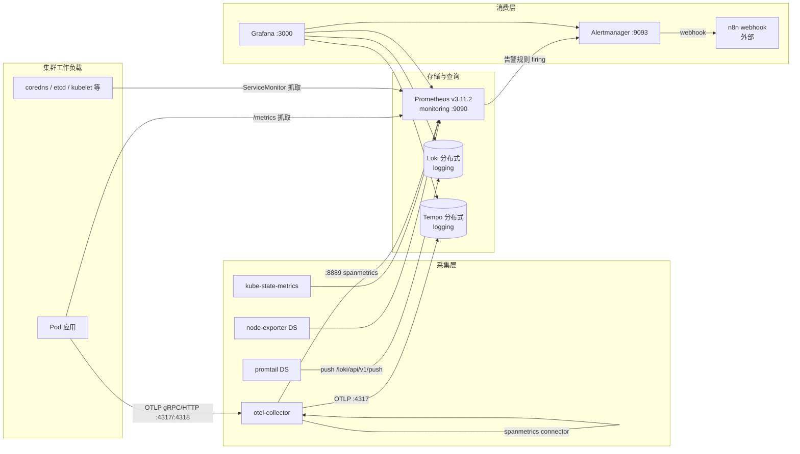

# Kubernetes 可观测性实战实验手册（基于本集群实测）

> 生成时间：2026-09-27 ｜ 集群：`kubernetes-admin@kubernetes`（v1.29.8，6 节点）
> **本文档中的所有命令与"实测输出"均已在你的集群上真实执行并验证**，输出为撰写时刻的真实值。
>
> 标记说明：
> - ✅ 已实测：命令跑通过，输出可信
> - ⚠️ 注意：容易踩的坑，本集群实际验证时确实踩到
> - 🛑 风险：可能影响生产业务，执行前先确认窗口

---

## 目录

- [0. 如何使用本文档](#0-如何使用本文档)
- [1. 集群与观测栈快照](#1-集群与观测栈快照实测)
- [2. 概念篇：可观测性到底是什么](#2-概念篇可观测性到底是什么)
- [3. 实验篇（实验 0 ~ 实验 10）](#3-实验篇实验-0--实验-10)
- [4. 日常运维篇](#4-日常运维篇)
- [5. 当前集群真实问题清单（实测证据）](#5-当前集群真实问题清单实测证据)
- [6. 掌握度自测](#6-掌握度自测)
- [7. 附录：速查表](#7-附录速查表)

---

# 0. 如何使用本文档

学习路径建议：

```
概念篇(2) → 实验0~2 → 实验4~5 → 实验6 → 实验7~8 → 日常运维(4) → 实验9~10
      └── 先建立"信号从哪来"的心智模型，再动手，最后形成肌肉记忆 ──┘
```

实验记录表（做完自己填，这是掌握度的证据）：

| 实验 | 完成日期 | 我的预期输出 | 实际输出 | 疑问 |
|---|---|---|---|---|
| 0 体检 |  |  |  |  |
| 1 PromQL |  |  |  |  |
| 2 USE/RED |  |  |  |  |
| 3 新增采集 |  |  |  |  |
| 4 日志 |  |  |  |  |
| 5 Trace |  |  |  |  |
| 6 三板斧 |  |  |  |  |
| 7 自定义告警 |  |  |  |  |
| 8 告警治理 |  |  |  |  |
| 9 容量 |  |  |  |  |
| 10 故障注入 |  |  |  |  |

---

# 1. 集群与观测栈快照（实测）

## 1.1 集群拓扑

```
NAME       ROLE            VERSION    INTERNAL-IP   OS                          RUNTIME
m01        control-plane   v1.29.8    10.0.0.61     Rocky Linux 9.6             containerd://1.7.22
master01   control-plane   v1.29.8    10.0.0.121    Ubuntu 22.04.5 LTS          containerd://1.7.22
master02   control-plane   v1.29.8    10.0.0.120    Ubuntu 22.04.5 LTS          containerd://1.7.22
worker01   <none>          v1.29.8    10.0.0.122    Ubuntu 22.04.5 LTS          containerd://1.7.22
worker02   <none>          v1.29.8    10.0.0.123    Ubuntu 22.04.5 LTS          containerd://1.7.22
worker03   <none>          v1.29.8    10.0.0.124    Ubuntu 22.04.5 LTS          containerd://1.7.22
```

- 网络：Calico；APIServer 高可用：kube-vip；存储：Ceph RBD(`ceph-rbd-sc`) + NFS(`nfs-sc`)
- Pod 规模（✅实测）：`kubectl get pods -A --no-headers | wc -l` → **163**
  （142 Running / 19 Completed / 1 Pending / 1 ImagePullBackOff / 1 CrashLoopBackOff）
- 命名空间 28 个，其中与观测相关：`monitoring`、`logging`、`opentelemetry`

## 1.2 观测栈组件清单

| 层 | 组件 | 命名空间 | 版本 | 部署方式 | 关键点 |
|---|---|---|---|---|---|
| 指标 | kube-prometheus-stack | monitoring | chart 83.7.0 / operator 0.90.1 | Helm `prometheus` | 单副本、30s 抓取、保留 5d/30GB |
| 指标 | Prometheus | monitoring | **v3.11.2** | CR `prometheus-prometheus` | PVC 100Gi(nfs-sc)，170k+ series |
| 指标 | Alertmanager | monitoring | v0.32.0 | CR | PVC 20Gi，通知发到 n8n webhook |
| 指标 | Grafana | monitoring | 随 chart | Deployment | 37 个仪表盘、4 个数据源 |
| 指标 | kube-state-metrics / node-exporter | monitoring | 随 chart | DS/Deploy | 对象状态 + 主机指标 |
| 日志 | Loki | logging | chart 6.55.0 / app 3.6.7 | Helm `loki` | read/write/backend 分布式，S3(Ceph RGW) |
| 日志 | Promtail | logging | chart 6.17.1 | DaemonSet 6/6 | `tenant_id: fake`，CRI 解析 |
| 链路 | Tempo | logging | chart 1.61.3 / app 2.9.0 | Helm `tempo` | 分布式，RF=3，块保留 48h |
| 链路 | OpenTelemetry Operator + Collector | opentelemetry | operator 0.106.0 / col 0.145.0 | Helm + CR | traces→Tempo，spanmetrics→Prometheus |
| 排查 | k9s / kubectl / helm | 本机 | — | 二进制 | `/usr/bin/kubectl`、`/usr/local/bin/helm`、`k9s` |

## 1.3 数据流架构（本集群实际连线）



**心智模型**：
- **指标 = 拉取（pull）**：Prometheus 按 ServiceMonitor 主动来抓
- **日志 = 推送（push）**：Promtail 在每个节点读容器日志，推给 Loki Gateway
- **链路 = 推送（push）**：应用/Collector 把 span 推给 Tempo distributor
- **三者靠 `service.name` / `namespace` / `trace_id` / `span_id` 关联**

## 1.4 关键配置参数（决定你"能查多久"）

| 维度 | 配置 | 实测值/位置 |
|---|---|---|
| 指标抓取间隔 | `scrapeInterval: 30s` | `kubectl get prometheus prometheus-prometheus -n monitoring` |
| 规则评估间隔 | `evaluationInterval: 30s` | 同上 |
| 指标保留 | `retention: 5d`、`retentionSize: 30GB` | `helm get values prometheus -n monitoring` |
| 指标存储 | PVC 100Gi `nfs-sc`，WAL 压缩开启 | 同上 |
| Alertmanager 保留 | `retention: 120h` | CR `prometheus-alertmanager` |
| 日志样本过期 | `reject_old_samples_max_age: 168h`（7d） | `kubectl get cm -n logging loki` |
| 日志采集丢弃 | `drop: older_than: 168h` | `helm get values promtail -n logging` |
| 日志索引 | schema v13 / tsdb / index period 24h | Loki config |
| 链路块保留 | `block_retention: 48h` | `kubectl get cm -n logging tempo-config` |
| 链路副本 | ingester 3 副本，`replication_factor: 3` | 同上 |
| Grafana 持久化 | 10Gi `nfs-sc` | helm values |

> ⚠️ **这就是"指标只有 5 天、链路只有 48 小时、日志 7 天"的出处**。做月度复盘前必须先把数据导出或调大保留。

## 1.5 访问入口与端口表

集群内组件都是 `ClusterIP`，统一用 port-forward。**推荐固定本地端口**：

| 服务 | 命令 | 本地地址 | 凭据 |
|---|---|---|---|
| Prometheus | `kubectl port-forward -n monitoring prometheus-prometheus-prometheus-0 9090:9090` | http://127.0.0.1:9090 | 无 |
| Grafana | `kubectl port-forward -n monitoring deploy/prometheus-grafana 3400:3000` | http://127.0.0.1:3400 | `admin` / 见 `helm get values prometheus -n monitoring` 的 `grafana.adminPassword` |
| Alertmanager | `kubectl port-forward -n monitoring svc/prometheus-alertmanager 19093:9093` | http://127.0.0.1:19093 | 无 |
| Loki Gateway | `kubectl port-forward -n logging svc/loki-gateway 3110:80` | http://127.0.0.1:3110 | 需 Header `X-Scope-OrgID: fake` |
| Tempo | `kubectl port-forward -n logging svc/tempo-query-frontend 3200:3200` | http://127.0.0.1:3200 | 无 |
| OTLP HTTP | `kubectl port-forward -n opentelemetry svc/otel-collector 4318:4318` | http://127.0.0.1:4318 | 无 |

🛑 **两个实测到的坑**：

1. **本机 9093 端口已被占用**。宿主机上跑着一个独立的旧版 Alertmanager（`/usr/local/bin/alertmanager --config.file=/etc/alertmanager/alertmanager.yml --web.listen-address=:9093`），配置是邮件通知（receiver `default-email`）。如果你直接 `port-forward ... 9093:9093` 会报 `address already in use`，而你 `curl localhost:9093` 拿到的**是宿主机那个旧实例，不是集群里的**——我就误判过一次（看到的 receiver、告警数全对不上）。
   ```bash
   ss -ltnp | grep 9093        # ✅ 实测：alertmanager  pid 1059（宿主机进程）
   curl -s localhost:9093/api/v2/receivers     # → [{"name":"default-email"}]   ← 假的
   curl -s localhost:19093/api/v2/receivers    # → [{"name":"n8n-webhook"}]     ← 真的
   ```
2. **Loki 必须带租户头**，否则返回 `no org id`（Loki `auth_enabled: true`，Promtail 用 `tenant_id: fake`）。
   ```bash
   curl -s -H 'X-Scope-OrgID: fake' http://127.0.0.1:3110/loki/api/v1/labels
   ```

---

# 2. 概念篇：可观测性到底是什么

## 2.1 监控 vs 可观测性

| | 监控（Monitoring） | 可观测性（Observability） |
|---|---|---|
| 问题 | 「已知的已知」：我知道要盯什么 | 「未知的未知」：出了新问题我能不能被数据引导出来 |
| 产物 | 仪表盘、告警 | 高基数指标 + 全文日志 + 全链路 trace + 关联跳转 |
| 判据 | 指标有没有超阈值 | 能不能不改代码就回答"为什么慢/为什么错" |

**本集群的对应物**：监控 = Prometheus + 36 组 PrometheusRule；可观测性 = 上面加上 Loki（上下文）+ Tempo（因果）+ Grafana 的跳转（关联）。

## 2.2 四种信号

| 信号 | 回答 | 本集群载体 | 成本 | 基数 |
|---|---|---|---|---|
| **Metrics 指标** | 有多严重？趋势如何？ | Prometheus / node-exporter / kube-state-metrics | 低 | 必须严格控制 |
| **Logs 日志** | 当时具体发生了什么？ | Promtail → Loki | 中 | 免费（相对） |
| **Traces 链路** | 请求在哪一跳慢的/错的？ | otel-collector → Tempo | 高 | — |
| **Profiles 剖析** | CPU/内存花在哪行代码？ | 暂未部署（可扩展 pyroscope） | 高 | — |

## 2.3 指标模型（必须吃透）

- **时间序列 = 指标名 + 一组 label**。`http_requests_total{method="GET", code="500"}`
- **cardinality（基数）= 指标名 × label 组合数**，是 Prometheus 内存与查询成本的第一杀手。
  🛑 绝不要把 `pod`、`trace_id`、`user_id`、`url(path with id)` 放进指标 label。
- 四种类型：

| 类型 | 语义 | 你必须用的函数 | 本集群例子 |
|---|---|---|---|
| Counter | 只增不减的累计 | **必须** `rate()` / `increase()` | `node_cpu_seconds_total`、`container_cpu_usage_seconds_total` |
| Gauge | 可增可减的瞬时值 | `avg/max/topk` | `node_memory_MemAvailable_bytes`、`kube_pod_status_ready` |
| Histogram | 分桶累计 + `_bucket{le=}` | `histogram_quantile(0.95, sum by(le)(rate(..._bucket[5m])))` | `apiserver_request_duration_seconds_bucket`、`flask http_request_latency_seconds_bucket` |
| Summary | 客户端算好分位数 | 直接取值 | 本集群少见 |

- ⚠️ **两个本集群实测到的坑**：
  1. `rate(node_cpu_seconds_total{mode="idle"}[5m])` 按 `node` 聚合 → **返回空**。
     因为 node-exporter 没有 `node` 这个 label，只有 `instance`/`pod`：
     ```promql
     1 - avg by (instance) (rate(node_cpu_seconds_total{mode="idle"}[5m]))   # ✅ 6 条
     1 - avg by (node)     (rate(node_cpu_seconds_total{mode="idle"}[5m]))   # ✅ 1 条且 label 全空（错误示范）
     ```
  2. `count by (namespace) (kube_pod_status_phase{phase="Pending"})` → 24，**错**。
     因为 `count` 数的是"序列条数"，每个 Pod 都有一条 phase 序列（值为 0 或 1）。必须比较值：
     ```promql
     count by (namespace) (kube_pod_status_phase{phase="Pending"} == 1)   # ✅ 1 (kube-system)
     ```

## 2.4 采集链路（Pull 模式）

```
Service(带 prometheus.io 注解或匹配 ServiceMonitor)
   → prometheus-operator 生成抓取配置（secret）
   → config-reloader 热加载 Prometheus
   → Prometheus 按 relabel 规则抓取 /metrics
   → 打上 job/instance/namespace/pod 等 label 落盘
```

本集群对象（✅实测）：
```bash
kubectl get servicemonitor -A      # 15 个（14 monitoring + 1 opentelemetry）
kubectl get prometheusrule  -A     # 36 个（含自定义 cluster-wide-alerts）
```
选择器：`serviceMonitorSelector.matchLabels: {release: prometheus}` —— **新建的 ServiceMonitor 必须带这个 label，否则不被抓**。

## 2.5 日志链路

```
容器 stdout/stderr → /var/log/pods/<ns>_<pod>_<uid>/<container>/*.log
   → promtail(DS, 每节点) → CRI 解析 → 附加 ns/pod/container/node label
   → push 到 loki-gateway → loki-write(接收) → S3(chunks) + tsdb index
   → loki-read 查询
```

**Loki 的核心设计**：label 只做"索引/分片"（低基数），内容全文检索靠 LogQL 的过滤表达式。所以：
- ✅ 好 label：`namespace`、`pod`、`container`、`app`、`node_name`
- 🛑 坏 label：`trace_id`、`message`、`level`（除非你确有分片需求）

LogQL 两段式：
```
{stream selector}  | json | field filters      ← log pipeline（选日志）
sum by (x) (rate({...} |= "error" [5m]))       ← metric query（算指标）
```

## 2.6 链路追踪（Tracing）

```
应用(OTLP SDK) ──► otel-collector(:4317/:4318)
                     ├─ traces → batch → tempo-distributor(:4317) → ingester(RF=3) → S3
                     └─ spanmetrics connector → metrics(:8889) → Prometheus 抓取
Tempo 自带 metrics-generator 也配了 service_graphs + span_metrics（但 remote_write 为空 → 未输出）
```

**spanmetrics 的价值**：把 trace 变成"每个服务/每个接口的 QPS、错误率、延迟分位"指标，
让"没有埋点的系统"也能有 RED 指标 —— 这是 metrics 和 traces 的**桥梁**。

本集群当前状态（✅实测）：
- `up{job="otel-collector"}` = 1，采集正常
- `count by (namespace) (traces_spanmetrics_calls_total)` = **0 条**
  → 因为 Prometheus exporter 配了 `namespace: otel_demo`，实际指标名是 `otel_demo_*`；且**集群里没有任何应用在发 trace**。
- 手工注入一条 trace → HTTP 200，Tempo distributor 日志出现 `received span`，但**查询 500**（见 §5 问题3）

## 2.7 告警链路（最容易被忽视的一环）

```
PrometheusRule(expr, for: 5m)
  → 评估为 pending（还没到 for）
  → 持续满足 → firing
  → POST 到 Alertmanager
  → route 分组(group_by/wait/interval) → inhibit 抑制 → 静默 silence 过滤
  → receiver(webhook/email/slack) → 通知
  → 条件消失 → resolved(也发一次)
```

本集群实测配置：
```yaml
route:
  group_by: [alertname, namespace, severity]
  group_wait: 30s        # 新组先等 30s，攒一批
  group_interval: 5m     # 同组新告警 5m 再发
  repeat_interval: 12h   # 持续 firing 每 12h 重复
  receiver: n8n-webhook
inhibit_rules:           # critical 抑制同 namespace 同 alertname 的 warning/info
```

三个必须分清的状态：
- **pending**：已触发但没到 `for`，不通知（防抖）
- **firing**：真通知
- **suppressed/inhibited**：被更高优先级告警抑制，AM 里显示 `suppressed`（我实验时就撞到过，见实验 7）

## 2.8 SLI / SLO / 错误预算

| 概念 | 定义 | 例子 |
|---|---|---|
| SLI | 服务质量的**度量** | 可用性=成功请求/总请求；延迟=P95 |
| SLO | SLI 的**目标值**（一段时间内） | 99.9% 可用 / P95 < 300ms |
| 错误预算 | `1 - SLO` = 允许的出错配额 | 99.9% → 每月允许 43.2 分钟不可用 |
| Burn rate | 消耗预算的速度 | burnrate=14 → 2 小时烧掉两周预算（用于多窗口告警） |

- **RED**（面向服务）：Rate / Errors / Duration → `flask-prom` 的 `http_request_latency_seconds_*`
- **USE**（面向资源）：Utilization / Saturation / Errors → `node_cpu_seconds_total`、队列长度、`node_network_receive_errs_total`

## 2.9 概念 → 验证动作对照表（建议贴墙上）

| 概念 | 在本集群怎么"看见"它 |
|---|---|
| 时间序列 & label | `curl -s localhost:9090/api/v1/label/job/values` |
| counter 需要 rate | `rate(node_cpu_seconds_total{mode="idle"}[5m])` |
| histogram 分位 | `histogram_quantile(0.95, sum by(le)(rate(http_request_latency_seconds_bucket[5m])))` |
| scrape 目标健康 | `curl -s localhost:9090/api/v1/targets \| jq '.data.activeTargets[].health'` |
| 采集配置来源 | `kubectl get servicemonitor -A` + `kubectl get secret -n monitoring -l prometheus=...` |
| 日志流选择器 | `curl -H 'X-Scope-OrgID: fake' localhost:3110/loki/api/v1/labels` |
| 日志→指标 | LogQL `topk(5, sum by(ns)(rate({...} \|~ "error" [5m])))` |
| trace 语义 | Grafana Tempo 搜索 `service.name` + TraceQL |
| 指标↔日志↔trace 关联 | Grafana Explore：面板 → Data Links → Loki/Tempo |
| 规则评估 | `curl -s localhost:9090/api/v1/rules \| jq` |
| 通知投递 | `curl -s localhost:9090/api/v1/query?query=alertmanager_notifications_failed_total` |
| 数据保留 | `/api/v1/status/tsdb`、`helm get values prometheus` |

---

# 3. 实验篇（实验 0 ~ 实验 10）

> 通用约定：下面所有 `curl localhost:9090/...` 前先开一个 Prometheus 端口转发：
> ```bash
> kubectl port-forward -n monitoring prometheus-prometheus-prometheus-0 9090:9090 &
> ```
> 每个实验的**「验证」小节给出的是我在你集群上跑出来的真实输出**，如果你的结果差异很大，先找差异原因，而不是继续往下做。

---

## 实验 0：观测栈体检（15 分钟）

**目标**：建立"我的观测链路哪些环节是活的"的整体印象，学会 5 分钟健康检查。

**步骤 1：组件状态**
```bash
kubectl get pods -n monitoring
kubectl get pods -n logging
kubectl get pods -n opentelemetry
helm list -A | grep -Ei 'prometheus|loki|tempo|otel|promtail'
```
✅ 预期：monitoring 13 个 Pod 全 Running；logging 的 Loki(read/write/backend/gateway/caches)、Promtail DS 6/6、Tempo 全组件 Running；otel-collector 1/1。

**步骤 2：抓取目标健康（观测链路的"心跳"）**
```bash
curl -s localhost:9090/api/v1/targets | python3 -c "
import json,sys
from collections import Counter
d=json.load(sys.stdin)['data']['activeTargets']
print(Counter(t['health'] for t in d), 'total', len(d))
for t in d:
    if t['health']!='up': print(' DOWN:', t['scrapePool'], t['labels'].get('instance'), '|', t['lastError'][:70])"
```
✅ 实测：`Counter({'up': 39, 'down': 16}) total 55`，down 的 16 个全部是控制面组件（etcd:2381 / kube-controller-manager:10257 / kube-scheduler:10259 / kube-proxy:10249 / coredns:9153）—— 见 §5 问题 1。
> 加上实验 3 新增的 Tempo 抓取后，现在是 **57 个目标 / 41 up / 16 down**。

**步骤 3：告警状态**
```bash
curl -s localhost:9090/api/v1/alerts | python3 -c "
import json,sys
d=json.load(sys.stdin)['data']['alerts']
print('总条数', len(d))
for a in d: print(a['state'],'|',a['labels'].get('alertname'),'|',a['labels'].get('namespace',''),'|',a['labels'].get('severity'))"
```
✅ 实测（2026-09-27）：18 条，其中 firing 16、pending 2，`Watchdog` 永远在（说明告警链路活着）。

**步骤 4：日志与链路的连通性**
```bash
kubectl port-forward -n logging svc/loki-gateway 3110:80 &
curl -s -H 'X-Scope-OrgID: fake' localhost:3110/loki/api/v1/labels
# 应返回 ["app","component","container","filename","instance","job","namespace","node_name","pod","service_name","stream",...]

kubectl get pods -n logging | grep -E 'loki-(read|write|backend)|tempo-'
kubectl exec -n logging deploy/tempo-querier -- sh -c 'wget -qO- http://127.0.0.1:3200/ready'  # → ready
```

**步骤 5：Grafana 资产盘点**
```bash
kubectl port-forward -n monitoring deploy/prometheus-grafana 3400:3000 &
PW=$(helm get values prometheus -n monitoring | python3 -c "import sys,yaml;print(yaml.safe_load(sys.stdin)['grafana']['adminPassword'])")
curl -s -u "admin:$PW" localhost:3400/api/search?type=dash-db | python3 -c "import json,sys;d=json.load(sys.stdin);print(len(d),'dashboards');[print(' -',x['title']) for x in d]"
curl -s -u "admin:$PW" localhost:3400/api/datasources | python3 -c "import json,sys;[print(x['name'],'|',x['type'],'|',x['url']) for x in json.load(sys.stdin)]"
```
✅ 实测：**37 个仪表盘**（K8S / Node / etcd / Traefik / ArgoCD / Loki stack / **OpenTelemetry & Tempo** / **Lightweight APM for OpenTelemetry** / Alertmanager…），**4 个数据源**：Prometheus、Alertmanager、loki、tempo（tempo 数据源已配置 `tracesToLogs`→loki、`tracesToMetrics`→prometheus，即"点 trace 跳日志/指标"的联动已经配好）。

**思考题**
1. 为什么 `up == 0` 的目标比"Pod 不健康"更常见？（提示：target 是抓取角度，不是 K8s 角度）
2. 如果整个 Prometheus 挂了，上面哪几个检查会失效？你还有什么替代手段？（提示：`kubectl top` 走的是 metrics-server）

---

## 实验 1：PromQL 基础与指标类型（45 分钟）

**目标**：能把"我想知道什么"翻译成正确的 PromQL，并识别 3 类典型错误。

### 1.1 认识数据
```bash
# 有哪些指标名
curl -s --get localhost:9090/api/v1/label/__name__/values | python3 -c "import json,sys;n=json.load(sys.stdin)['data'];print(len(n),'个指标名');print(n[:20])"
# 某个指标有哪些标签
curl -s --get localhost:9090/api/v1/series --data-urlencode 'match[]=kube_pod_info' --data-urlencode 'start=1790515000' | python3 -c "import json,sys;print(sorted(json.load(sys.stdin)['data'][0].keys()))"
```

### 1.2 Instant / Range 查询
```bash
# 瞬时值
curl -s --get localhost:9090/api/v1/query --data-urlencode 'query=up{job="node-exporter"}'
# 区间向量（画图用）
curl -s --get localhost:9090/api/v1/query_range --data-urlencode 'query=rate(node_cpu_seconds_total{mode="user"}[5m])' \
  --data-urlencode "start=$(date -d '-1 hour' +%s)" --data-urlencode "end=$(date +%s)" --data-urlencode 'step=60' | head -c 300
```

### 1.3 Counter 必须 rate（已验证对比）
```promql
# ❌ 原始 counter：单调上升的"累计"，直接看没意义
node_cpu_seconds_total{mode="idle"}

# ✅ 每秒速率
rate(node_cpu_seconds_total{mode="idle"}[5m])

# ✅ 最近 1 小时累计消耗（核·秒）
increase(node_cpu_seconds_total{mode="idle"}[1h])
```

### 1.4 Histogram 分位（本集群可跑）
```promql
# API Server P99 延迟
histogram_quantile(0.99, sum by (le) (rate(apiserver_request_duration_seconds_bucket[5m])))
# ✅ 实测返回 60（秒，样本稀疏时落到最大桶，属正常）

# CoreDNS 查询速率
sum(rate(coredns_dns_requests_total[5m]))
# ✅ 实测 ~10.38 /s
```

### 1.5 三个已验证的典型错误 ⚠️
| # | 错误查询 | 症状 | 正确写法 |
|---|---|---|---|
| 1 | `avg by (node)(rate(node_cpu_seconds_total{mode="idle"}[5m]))` | 返回 1 条且 label 全空 | 用 `by (instance)`（本集群没有 `node` label） |
| 2 | `count by (namespace)(kube_pod_status_phase{phase="Pending"})` | 报 24，虚高 | `count by (namespace)(kube_pod_status_phase{phase="Pending"} == 1)` → 1 |
| 3 | `rate(...)` 里直接管道符 `{ns=~".+"} \|~ "error"` | `parse error: unexpected character: \|` | PromQL **不支持**日志管道，日志指标化要用 LogQL |

### 1.6 用 recording rules 简化（本集群已有）
```bash
kubectl get prometheusrule -n monitoring prometheus-kube-prometheus-node-recording.rules -o yaml | grep -E 'record:|expr:' | head -10
```
✅ 你可以直接复用现成的录制规则，例如节点 5 分钟 CPU 使用率 `node:node_cpu_usage:rate5m`（免去每次手写 rate+聚合）。

**练习**：不查资料，写出"过去 15 分钟内重启过 ≥2 次的容器"查询，然后验证：
```promql
topk(10, increase(kube_pod_container_status_restarts_total[15m]))
```
✅ 实测能列出 `gitlab-runner/gitlab-runner-6c678959c8-4qvph`、`cnpg-system/pg16-ceph-2` 等。

---

## 实验 2：USE / RED 方法落地（45 分钟）

**目标**：用固定套路回答"集群健康吗 / 服务健康吗"。

### 2.1 节点 USE（Utilization / Saturation / Errors）
```promql
# U: CPU 使用率（按节点）
1 - avg by (instance) (rate(node_cpu_seconds_total{mode="idle"}[5m]))
# U: 内存使用率
1 - node_memory_MemAvailable_bytes / node_memory_MemTotal_bytes
# U: 磁盘使用率（排除 tmpfs/overlay）
100 * (1 - node_filesystem_avail_bytes{fstype!~"tmpfs|overlay"} / node_filesystem_size_bytes{fstype!~"tmpfs|overlay"})
# S: 运行队列长度（> CPU 核数即饱和）
node_load5 / count by (instance) (rate(node_cpu_seconds_total{mode="idle"}[5m]))
# S: 内存换出压力
vmstat_memory_commited_as_bytes  / node_memory_MemTotal_bytes
# E: 网络错误 / 丢包
rate(node_network_receive_errs_total[5m]) + rate(node_network_transmit_errs_total[5m])
```
✅ 实测：CPU 最高 m01 ≈ 20%、其余 9~14%；内存 m01 66%、master02 66%、worker03 26%；网络错误全 0。
配合 `kubectl top nodes` 交叉验证（metrics-server，实时值）：
```
m01 745m/18% 3892Mi/69%   master01 342m/8% 2843Mi/48%   master02 358m/8% 2549Mi/66%
worker01 619m/10% 5160Mi/52%   worker02 456m/7% 5560Mi/56%   worker03 316m/7% 2674Mi/34%
```

### 2.2 存储
```promql
# PV 使用率（11 个 PVC）
kubelet_volume_stats_used_bytes / kubelet_volume_stats_capacity_bytes
# 剩余可用比例 Top3
topk(3, kubelet_volume_stats_available_bytes / kubelet_volume_stats_capacity_bytes)
# 各命名空间 CPU 消耗
sum by (namespace) (rate(container_cpu_usage_seconds_total{image!=""}[5m]))
```
✅ 实测最紧张的三个 PVC：kafka 0.999、logging 0.998、n8n 0.997（**注意：这是"剩余比例"接近 1 = 很空**，别读反了！公式是 `available/capacity`）。

### 2.3 应用 RED（用 flask-prom，真实产生流量）
flask-prom 是集群里的示例服务（`monitoring/flask-prom`，镜像 `10.0.0.41/library/flask-prom-demo`）。
```bash
kubectl port-forward -n monitoring svc/flask-prom 15000:80 &   # ⚠️ Service 端口是 80，不是 5000
# 打点流量：POST /order 是真实接口（GET 会 405）
for i in $(seq 1 100); do
  curl -s -o /dev/null -X POST localhost:15000/order -H 'Content-Type: application/json' -d '{"item":"book","qty":1}'
  curl -s -o /dev/null localhost:15000/
done
```
然后看 RED：
```promql
# Rate
sum(rate(http_request_latency_seconds_count[3m]))
# Duration（分位）
histogram_quantile(0.95, sum by (le) (rate(http_request_latency_seconds_bucket[3m])))
# Duration（平均，最稳）
sum(rate(http_request_latency_seconds_sum[3m])) / sum(rate(http_request_latency_seconds_count[3m]))
```
✅ 实测（打完 100+ 流量后）：RPS ≈ **0.58/s**，P95 ≈ **1.899s**，平均延迟 = `sum/count` ≈ **0.76s**，真实 `curl -w time_total` 实测单请求 0.3~1.0s → **指标和真实体感一致**。

**两个必须理解的观察**（这是本实验最有价值的部分）：
1. `http_request_latency_seconds_count` **没有任何 label**（没有 route/method/status）：
   ```bash
   curl -s localhost:15000/metrics | grep '^http_request_latency_seconds_count'
   # http_request_latency_seconds_count 134.0     ← 裸的，不带 {}
   ```
   → 后果：`sum by (route)` 只能得到一条空 label 结果，**你无法定位是哪个接口慢**。
   → 教训：**RED 指标必须带低基数维度**（route/method/status_code），否则只能知道"慢"，不能知道"谁慢"。
2. Histogram 桶是 `le=0.2/0.5/1/2/3/5`，太粗 → P95 只能落在 2s 桶里（误差巨大）。
   → 教训：**桶边界要贴着你的 SLO 设计**（例如 SLO 是 300ms，桶就必须有 0.1/0.2/0.3/0.5）。

**练习**：给 flask-prom 加一个 route label 会带来多少基数？（= route 数 × method 数 × status 数），并说明为什么不能加 `order_id`。

---

## 实验 3：新增一个采集目标（30 分钟）✅ 已实测，且**已在集群保留**

**目标**：理解 ServiceMonitor → operator → 抓取配置 → target 的完整链路，掌握"新组件怎么接进 Prometheus"。

**背景**：本集群的 Tempo **原本没有被监控**（当时全集群只有 14 个 ServiceMonitor；2026-11-11 复核为 27 个 + 16 个 PodMonitor）。我们给它加上。

**步骤 1：看懂目标 Service 的 label 与端口名**
```bash
kubectl get svc tempo-distributor -n logging --show-labels
kubectl get svc tempo-distributor -n logging -o jsonpath='{.spec.ports}'
```
✅ 实测 label：`app.kubernetes.io/component=distributor, app.kubernetes.io/name=tempo, ...`；端口名 `http-metrics`(3200)、`grpc`(9095)、`distributor-otlp-http`(4318)…

**步骤 2：创建 ServiceMonitor**
```yaml
# /tmp/sm-tempo.yaml
apiVersion: monitoring.coreos.com/v1
kind: ServiceMonitor
metadata:
  name: tempo-self-monitor
  namespace: monitoring
  labels:
    release: prometheus        # ① 必须匹配 Prometheus 的 serviceMonitorSelector
spec:
  namespaceSelector:
    matchNames: [logging]      # ② 跨命名空间必须显式声明
  selector:
    matchLabels:               # ③ 必须和 Service label 完全一致
      app.kubernetes.io/name: tempo
      app.kubernetes.io/component: distributor
  endpoints:
    - port: http-metrics       # ④ 端口「名」，不是端口号
      interval: 30s
      path: /metrics
```
```bash
kubectl apply -f /tmp/sm-tempo.yaml
```

**步骤 3：验证链路（三步都要看）**
```bash
# a. operator 有没有同步
kubectl logs -n monitoring deploy/prometheus-operator --since=3m | grep 'sync prometheus'
# b. 抓取配置里有没有生成 job
kubectl get secret prometheus-prometheus-prometheus -n monitoring -o jsonpath='{.data.prometheus\.yaml\.gz}' \
  | base64 -d | gunzip | grep -A6 'tempo-self-monitor'
# c. target 是否 up（约 60~90 秒后）
curl -s localhost:9090/api/v1/targets | python3 -c "..."
```
✅ 实测结果：
```
serviceMonitor/monitoring/tempo-self-monitor/0 | 10.244.30.113:3200 | up
```
配置里生成的 job：
```yaml
- job_name: serviceMonitor/monitoring/tempo-self-monitor/0
  kubernetes_sd_configs: [{role: endpoints, namespaces: {names: [logging]}}]
  # relabel: label app.kubernetes.io/name == tempo && component == distributor && port name == http-metrics
```

**步骤 4：新指标立刻可用，并且发现了问题**
```promql
count by (name, state) (tempo_ring_members)
topk(5, tempo_distributor_bytes_received_total)
```
✅ 实测：`tempo_ring_members{name="ingester", state="Unhealthy"}` = **2**（3 个 ingester 里 2 个不健康）→ **观测盲区一打开就暴露了 §5 问题 3**。这就是"可观测性"的价值：先看见，才谈得上治理。

### ⚠️ 本实验踩到的坑（我第一次就写错了）
```yaml
selector:
  matchLabels:
    app.kubernetes.io/name: tempo-distributor   # ❌ 实际是 name=tempo + component=distributor
```
症状：配置里有 job，但 `/api/v1/targets` **根本不出现这个 scrapePool**（0 个 endpoint 连 pool 都不建）。
排查顺序：`kubectl get svc --show-labels` → 对照 `matchLabels` → 对照 `endpoints[].port` 是**端口名**。
另一个坑：**忘记 `release: prometheus` label** → operator 压根不看它（`serviceMonitorSelector.matchLabels: {release: prometheus}`）。

**进阶练习**：照葫芦画瓢给 `loki-gateway`、`tempo-query-frontend` 也加上；并思考为什么 16 个控制面 target 是 down 的（→ §5 问题 1）。

---

## 实验 4：日志（Loki/LogQL）（45 分钟）

**目标**：掌握日志的"选流 → 过滤 → 聚合"三段式，能从日志回答指标提出的问题。

### 4.1 验证日志管道（端到端，已实测）
```bash
kubectl run obs-lab-log --image=busybox:1.36 --restart=Never -- \
  sh -c 'for i in 1 2 3 4 5; do echo "ERROR obs-lab-demo request failed id=$i"; sleep 1; done'
sleep 20
kubectl port-forward -n logging svc/loki-gateway 3110:80 &
curl -s -H 'X-Scope-OrgID: fake' --get localhost:3110/loki/api/v1/query_range \
  --data-urlencode 'query={namespace="default"} |= "obs-lab-demo"' --data-urlencode 'limit=10'
kubectl delete pod obs-lab-log
```
✅ 实测输出（20 秒内查到）：
```
streams: 2
 labels: {'namespace':'default','pod':'obs-lab-log','container':'obs-lab-log','node_name':'worker01'}
    ERROR obs-lab-demo request failed id=5 ... id=1
    INFO obs-lab-demo done
```
→ 说明 `容器 stdout → /var/log/pods → promtail(DS) → loki-gateway → loki-write → 查询` 全通。

### 4.2 三种查询形态
```logql
# ① 流选择器 + 过滤（查上下文）
{namespace="gitlab-runner"} |= "panic"
{namespace="monitoring"} |~ "(?i)error|warn" | json

# ② 指标化（回答"哪个命名空间错误最多"）
topk(5, sum by (namespace) (rate({namespace=~"logging|monitoring"} |~ "(?i)error|warn" [5m])))
# ✅ 实测：monitoring 0.5567 行/s，logging 0.01 行/s

# ③ 分组统计（排障常用）
sum by (pod) (count_over_time({namespace="kube-system"} |= "failed" [1h]))
```
curl 版（带租户头）：
```bash
curl -s -H 'X-Scope-OrgID: fake' --get localhost:3110/loki/api/v1/query_range \
  --data-urlencode 'query=topk(5, sum by (namespace) (rate({namespace=~"logging|monitoring"} |~ "(?i)error|warn" [5m])))'
```

### 4.3 用日志解释指标（真实案例：CrashLoop）
指标告诉我们"谁在重启"：
```promql
topk(5, increase(kube_pod_container_status_restarts_total[1h]))
# ✅ 实测 #1: gitlab-runner/gitlab-runner-6c678959c8-4qvph ≈ 10 次/小时
```
日志告诉我们"为什么"：
```bash
kubectl logs -n gitlab-runner deploy/gitlab-runner --previous --tail=50
# 或从 Loki 查历史（Pod 已重建时日志还在）
curl -s -H 'X-Scope-OrgID: fake' --get localhost:3110/loki/api/v1/query_range \
  --data-urlencode 'query={namespace="gitlab-runner"} |= "ERROR"' --data-urlencode 'limit=20'
```
指标 vs 日志的分工：
| 问题 | 用谁 |
|---|---|
| 重启多快、影响多大 | 指标 `rate(restarts)` |
| 这一次到底报了什么 | 日志 |
| 是否和时间点相关 | 两者对齐时间轴（Grafana Explore 同屏） |

### 4.4 保留与检索的取舍（本集群配置）
```bash
kubectl get cm -n logging loki -o jsonpath='{.data.config\.yaml}' | grep -A6 limits_config
helm get values promtail -n logging
```
✅ 实测：`reject_old_samples_max_age: 168h`（7 天前的日志**写不进去**），promtail `drop: older_than: 168h`。
→ 所以"查上个月的日志"在本集群是查不到的；要长期留存需要开 Loki compactor retention 或接归档。

**练习**：写一条 LogQL，统计过去 1 小时每个节点（`node_name`）的 error 日志速率，并找出最吵的节点。

---

## 实验 5：链路（OTLP 注入与查询）（30 分钟）

**目标**：理解 trace 的生产 → 采集 → 存储 → 查询全链路，并亲手造一条 trace。

### 5.1 手工注入一条 OTLP trace（✅ 已实测）
```bash
kubectl port-forward -n opentelemetry svc/otel-collector 4318:4318 &
TRACE_ID=$(printf '%032x' $((RANDOM*65536+RANDOM)))
SPAN_ID=$(printf '%016x' $((RANDOM*65536+RANDOM)))
NOW=$(date +%s%N)     # ⚠️ 必须是纳秒（19 位），多补 000 会 400: value out of range
cat > /tmp/trace.json <<EOF
{"resourceSpans":[{"resource":{"attributes":[
  {"key":"service.name","value":{"stringValue":"obs-lab-demo"}},
  {"key":"deployment.environment","value":{"stringValue":"lab"}}]},
 "scopeSpans":[{"scope":{"name":"lab"},"spans":[{
  "traceId":"$TRACE_ID","spanId":"$SPAN_ID","name":"GET /lab/hello","kind":2,
  "startTimeUnixNano":"$NOW","endTimeUnixNano":"$((NOW+15000000))","status":{"code":1},
  "attributes":[{"key":"http.request.method","value":{"stringValue":"GET"}},
                {"key":"http.route","value":{"stringValue":"/lab/hello"}},
                {"key":"http.response.status_code","value":{"intValue":"200"}}]}]}]}]}
EOF
curl -s -X POST -H 'Content-Type: application/json' --data @/tmp/trace.json localhost:4318/v1/traces -w '\nHTTP=%{http_code}\n'
```
✅ 实测：`HTTP=200` → `{"partialSuccess":{}}`

**验证它真的到了 Tempo**（看 distributor 日志，这是最直接的证据）：
```bash
kubectl logs -n logging deploy/tempo-distributor --tail=20 | grep received
# ✅ 实测：msg=received spanid=000000002b5b2ac4 traceid=0000000000000000000000001a781587
```

### 5.2 查询（当前会失败 → 这就是最好的排障教材）
```bash
kubectl port-forward -n logging svc/tempo-query-frontend 3200:3200 &
curl -s "localhost:3200/api/traces/$TRACE_ID"
curl -s 'localhost:3200/api/search?tags=service.name%3Dobs-lab-demo'
```
❌ 实测：
```
error querying ingesters in Querier.FindTraceByID: forIngesterRings:
error getting replication set for ring (0): too many unhealthy instances in the ring
```
**排障链（完整走一遍你就懂"可观测性"了）**：
```bash
# 1) 采集端在报错 → 已经定位到写入失败
kubectl logs -n opentelemetry deploy/otel-collector --tail=50 | grep -i error
#   Exporting failed ... at least 2 live replicas required, could only find 1
#   - unhealthy instances: 10.244.19.97:9095, 10.244.5.34:9095
# 2) Tempo 自身指标（实验 3 加的 ServiceMonitor 正好派上用场）
#   tempo_ring_members{name="ingester",state="ACTIVE"} = 1 / Unhealthy = 2
# 3) 是网络问题吗？—— 用一次主动探测排除
kubectl run t --rm -i --restart=Never --image=busybox:1.36 -- \
  sh -c 'for t in 10.244.19.97:9095 10.244.5.34:9095 10.244.19.97:7946 10.244.5.34:7946; do
           ip=${t%:*};p=${t#*:}; nc -z -w2 $ip $p >/dev/null 2>&1 && echo "OK $t" || echo "FAIL $t"; done'
#   ✅ 实测：4 个全部 OK → 网络通，问题在 Tempo 成员状态本身（ring 状态卡住）
# 4) 成员数量与健康（memberlist 视角）
#   tempo-dns-provider-results{addr="dns+tempo-gossip-ring:7946"} = 7   ← 7 个节点都在 gossip
#   但 ring 只有 1 个 ACTIVE → 状态不一致
```
**结论**：网络 OK、成员在 gossip、ring 却有 2 个 Unhealthy → 属于 **Tempo ingester ring 状态卡死**（发生于约 8 小时前的那次全集群重启/网络抖动），处置见 §5 问题 3 与 Runbook。

### 5.3 理解 spanmetrics（metrics ↔ traces 的桥）
```promql
# 当前为空，因为集群里没有业务应用在发 trace
count by (namespace) (traces_spanmetrics_calls_total)
# otel-collector 自身是被采集的
up{namespace="opentelemetry"}
```
✅ 实测：`up{job="otel-collector"} = 1`；spanmetrics 序列 0 条。
指标名实际带 `otel_demo_` 前缀（collector 配了 `namespace: otel_demo`），所以搜指标名时要 `otel_demo_*`。

**思考题**：为什么 trace 走 push、指标走 pull？为什么 Prometheus 不直接拉 trace？

---

## 实验 6：三板斧关联排障（60 分钟，核心实验）

**目标**：固化 `指标 → 日志 → 链路` 的排障动线，能在告警来的时候不慌。

**场景**：Alertmanager 里有一条 `PodCrashLooping` 告警（namespace=gitlab-runner）。

| 步 | 问什么 | 用什么 | 本集群实操 |
|---|---|---|---|
| 1 定位 | 谁在崩？多严重？ | 指标 | `kubectl get pods -n gitlab-runner`；`rate(kube_pod_container_status_restarts_total[15m])`；`kubectl describe pod -n gitlab-runner` |
| 2 量化 | 影响面？趋势？ | 指标 | `kube_deployment_status_replicas_available`、`kube_pod_status_ready`、Grafana「Kubernetes / Workload」面板 |
| 3 找原因 | 崩之前发生了什么 | 日志 | `kubectl logs --previous`；Loki `{namespace="gitlab-runner"} \|~ "error\|panic"`；对齐时间轴看事件 |
| 4 定位代码路径 | 哪一跳慢/错 | 链路 | 对已接入 OTLP 的服务：Grafana Explore → Tempo → `service.name` 过滤 → 点 span 看 attributes |
| 5 复盘 | 是否复发？要不要加告警 | 规则 | 写 PrometheusRule + runbook 链接 |

**本集群可直接演练的三组真实场景**：
1. **gitlab-runner CrashLoopBackOff（2506 次重启）**
   ```bash
   kubectl describe pod -n gitlab-runner -l app=gitlab-runner | tail -20
   kubectl logs -n gitlab-runner deploy/gitlab-runner --previous --tail=50
   curl -s -H 'X-Scope-OrgID: fake' --get localhost:3110/loki/api/v1/query_range \
     --data-urlencode 'query={namespace="gitlab-runner"}' --data-urlencode 'limit=20'
   ```
2. **16 个控制面 target down**
   ```bash
   curl -s localhost:9090/api/v1/targets | jq -r '.data.activeTargets[]|select(.health!="up")|
     [.scrapePool,.labels.instance,.lastError]|@tsv'
   # 网络层排除：kubectl exec/netshoot 直接连 10.0.0.120:10257 / 2381 / 10249
   # 结论方向：ServiceMonitor 指向的是「宿主机端口」，而组件只监听 127.0.0.1 或端口未开放
   ```
3. **CoreDNS ImagePullBackOff（DNS 单副本运行）**
   ```bash
   kubectl get pods -n kube-system -l k8s-app=kube-dns -o wide
   kubectl describe pod -n kube-system coredns-7bf7bd7987-k7f47 | grep -A3 Events
   # 同时观察到：Loki/Tempo 日志里大量 "server misbehaving"（DNS 抖动）
   ```

**掌握标准**：能在 10 分钟内，从任意一条 firing 告警走到"根因假设 + 验证证据"。

---

## 实验 7：自定义告警全链路（45 分钟）✅ 已实测

**目标**：完整走通 `规则 → 评估 → firing → Alertmanager → 抑制 → 通知`，并理解每一步的排错点。

**步骤 1：创建一个"必然触发"的规则**
```bash
cat > /tmp/lab-alert.yaml <<'EOF'
apiVersion: monitoring.coreos.com/v1
kind: PrometheusRule
metadata:
  name: obs-lab-test-alert
  namespace: monitoring
  labels:
    release: prometheus      # ① 必须，否则 ruleSelector 选不中
    app: obs-lab
spec:
  groups:
    - name: obs-lab.rules
      rules:
        - alert: ObsLabAlwaysFiring
          expr: vector(1) > 0
          for: 0m
          labels: {severity: info, lab: "true"}
          annotations:
            summary: "观测性实验用告警（可随时删除）"
            description: "验证 Prometheus -> Alertmanager 链路"
EOF
kubectl apply -f /tmp/lab-alert.yaml
```

**步骤 2：验证规则被加载并评估**（约 30~90 秒）
```bash
kubectl get prometheusrule obs-lab-test-alert -n monitoring -o jsonpath='{.metadata.annotations}'
#   ✅ "prometheus-operator-validated":"true"  ← operator 校验通过
curl -s --get localhost:9090/api/v1/rules | python3 -c "..."   # 找 obs-lab.rules
#   ✅ 实测：group=obs-lab.rules  state=firing  health=ok  evaluationTime=0.000670845
curl -s localhost:9090/api/v1/alerts | grep ObsLab
#   ✅ state=firing, value=1e+00
```
⚠️ 踩坑：刚 apply 完立刻查是 `state=unknown / health=unknown`（**还没被评估**），要等 `evaluationInterval: 30s` 一个周期。

**步骤 3：确认 Alertmanager 收到**
```bash
kubectl port-forward -n monitoring svc/prometheus-alertmanager 19093:9093 &   # ⚠️ 别用 9093！
curl -s localhost:19093/api/v2/alerts | python3 -c "..."
```
✅ 实测：AM 中 `ObsLabAlwaysFiring` 到达，但状态是：
```json
{"state":"suppressed","inhibitedBy":["aa18b88426ec889b"]}
```
→ 查 `aa18b88426ec889b` 是谁：**`InfoInhibitor`**。
→ 教学点：**AM 收到了 ≠ 会通知**。`inhibit_rules` 里 `severity=info` 的告警被 InfoInhibitor 规则抑制了；
   这也是为什么生产上不要随手把告警设成 `info`（除非你明确知道路由与抑制策略）。

**步骤 4：验证通知投递（本集群当前是失败的）**
```bash
curl -s --get localhost:9090/api/v1/query --data-urlencode 'query=alertmanager_notifications_failed_total'
kubectl logs -n monitoring alertmanager-prometheus-alertmanager-0 -c alertmanager --tail=100 | grep -i 'Notify attempt failed'
```
✅ 实测：
```
Notify attempt failed ... receiver=n8n-webhook integration=webhook attempts=15
err="Post <redacted>: read tcp 10.244.5.48:...->104.21.18.107:443: read: connection reset by peer"
```
→ **告警产生了，但通知没发出去**（外部 n8n webhook 连接被重置）。见 §5 问题 2。
→ 这就是"告警链路自身也要被观测"的原因：`AlertmanagerFailedToSendAlerts` 正是 AM 自监控告警。

**步骤 5：清理**
```bash
kubectl delete -f /tmp/lab-alert.yaml     # ✅ 已删除，集群无残留
# 注意：规则删除后，Prometheus 里该告警要过一个评估周期才会变 resolved
```

**练习**：把 `expr` 换成一个有业务价值的，例如"任意 Deployment 可用副本 0 超过 5 分钟"：
```yaml
- alert: DeploymentFullyUnavailable
  expr: kube_deployment_status_replicas_available == 0 and kube_deployment_spec_replicas > 0
  for: 5m
  labels: {severity: critical}
  annotations:
    summary: "{{ $labels.namespace }}/{{ $labels.deployment }} 完全不可用"
    runbook_url: "https://wiki.internal/runbook/xxx"    # 一定要有！
```
**评审要点**：`for` 要防抖、`severity` 要分级、`summary` 要一眼看懂、`runbook_url` 必填、label 不要放高基数字段。

---

## 实验 8：告警治理 — 分组 / 抑制 / 静默（30 分钟）✅ 已实测

**目标**：让告警"该响的响、不该响的闭嘴"，掌握三种手段的适用场景。

### 8.1 静默（Silence）—— 临时压制（变更窗口用）
```bash
START=$(date -u +%Y-%m-%dT%H:%M:%SZ); END=$(date -u -d '+30 minutes' +%Y-%m-%dT%H:%M:%SZ)
curl -s -X POST localhost:19093/api/v2/silences -H 'Content-Type: application/json' -d "{
  \"matchers\":[{\"name\":\"alertname\",\"value\":\"TargetDown\",\"isRegex\":false,\"isEqual\":true}],
  \"startsAt\":\"$START\",\"endsAt\":\"$END\",
  \"createdBy\":\"obs-lab\",\"comment\":\"变更窗口\"}"
# → {"silenceID":"330dba1c-..."}
curl -s localhost:19093/api/v2/alerts | grep -A3 TargetDown
# ✅ 实测：{"state":"suppressed","silencedBy":["330dba1c-..."]}  ← 立即生效
# 清理
curl -s -X DELETE localhost:19093/api/v2/silence/<id>
# ✅ 删除后 state 立刻回到 active
```
⚠️ 我第一次踩的坑：`startsAt` 手填了未来时间 → silence 状态是 `pending`，告警**没被静默**。用 `date -u` 生成。

| 手段 | 有效期 | 适用 |
|---|---|---|
| Silence | 你指定的时间窗 | 计划内变更、已知故障处理中 |
| Inhibit | 源告警存续期间 | critical 压住同级 warning（降噪） |
| Mute | — | Grafana Alerting 的静音 |

### 8.2 抑制（Inhibit）—— 本集群现有策略
```bash
kubectl get secret alertmanager-prometheus-alertmanager -n monitoring \
  -o jsonpath='{.data.alertmanager\.yaml}' | base64 -d | sed -n '1,40p'
```
✅ 现有规则（已验证）：
- `critical` 抑制同 `namespace+alertname` 的 `warning|info`
- `warning` 抑制同 `namespace+alertname` 的 `info`
- `InfoInhibitor` 抑制所有 `severity=info`（**这就是实验 7 中 info 告警变 suppressed 的原因**）

### 8.3 分组（Grouping）—— 避免告警风暴
```yaml
group_by: [alertname, namespace, severity]
group_wait: 30s        # 新告警组先攒 30s
group_interval: 5m     # 同组新增 5m 再通知
repeat_interval: 12h   # 持续 firing 每 12h 重复
```
**自检**：如果某个节点宕机产生 30 条 Pod 告警，这套配置会发几条？（按 namespace+severity 分组 → 通常 1~3 条，而不是 30 条）

**练习**：为"计划内滚动升级"设计一条 Silence：匹配 `namespace=argocd`、时长 20 分钟、`createdBy` 写你的名字。

---

## 实验 9：容量、保留与成本（30 分钟）

**目标**：知道"能看多久、还剩多少、什么时候会炸"。

```bash
# 1. TSDB 现状
curl -s localhost:9090/api/v1/status/tsdb | python3 -m json.tool | head -40
#   ✅ 实测：numSeries=170188, chunkCount=492332, numLabelPairs=11402
#   top series: apiserver_request_duration_seconds_bucket 15390, etcd_request_duration_seconds_bucket 13360 ...
# 2. 保留策略
helm get values prometheus -n monitoring | grep -A6 'prometheusSpec'
#   ✅ retention: 5d / retentionSize: 30GB / PVC 100Gi(nfs-sc)
# 3. 存储占用
kubectl get pvc -n monitoring
kubectl get pv | grep -E 'monitoring|logging'
# 4. 服务自身资源
kubectl top pods -n monitoring --sort-by=memory
#   ✅ 实测：prometheus 158m/780Mi，grafana 7m/299Mi，alertmanager 3m/35Mi
# 5. 日志/链路保留
kubectl get cm -n logging loki -o jsonpath='{.data.config\.yaml}' | grep -E 'reject_old_samples|max_age|compactor' -A3
kubectl get cm -n logging tempo-config -o jsonpath='{.data.tempo\.yaml}' | grep -A3 block_retention
#   ✅ 日志 7 天，链路 48 小时
```

**容量判断套路**：
| 指标 | 健康 | 预警 |
|---|---|---|
| 每秒新增序列 | 稳定 | 突增 2 倍（label 设计变更/新服务上线） |
| chunk 数 / series | < 3 | > 5（大量短命 series，常见于 label 用 pod/uid） |
| 磁盘增长 | 线性 | 超过 `retentionSize` 会**提前丢最老数据** |
| 抓取耗时 | < interval/2 | 接近 30s 会 scrape 超时、出现 gap |

**练习**：估算"把指标保留从 5d 调到 30d 需要多少磁盘"（当前 30GB/5d ≈ 6GB/天 → 30d ≈ 180GB，且要确认 nfs-sc 支持扩容）。

---

## 实验 10：故障注入演练（60 分钟）🛑 有风险

**原则**：只在非关键命名空间（`default`/`monitoring`）做、时间不超过 10 分钟、**注入前先记录现场、注入后必须恢复并复盘**。

| 注入 | 命令 | 观察点 | 恢复 |
|---|---|---|---|
| 日志管道 | `kubectl run obs-lab-log --image=busybox:1.36 --restart=Never -- sh -c 'echo ERROR test'` | 20s 内 Loki 能查到 | `kubectl delete pod obs-lab-log` |
| 副本不可用 | `kubectl scale deploy flask-prom -n monitoring --replicas=0` | `kube_deployment_status_replicas_available` 归零、Grafana Workload 面板变红 | `--replicas=2` |
| 节点封锁 | `kubectl cordon worker03` | 新 Pod 调度变化、`kube_node_status_condition` | `kubectl uncordon worker03` |
| 崩溃循环 | 部署一个 `command: ["sh","-c","exit 1"]` 的 Pod | `PodCrashLooping` pending→firing（**等 `for:` 才 firing**）、Loki 里能看到容器日志 | 删除 |
| 静默验证 | 对上面的告警建 Silence | AM 中变 `suppressed` | 删除 silence |
| 观测栈自残 | 🛑 **不要** kill Prometheus/etcd | — | — |

**验证清单（做完必须全绿）**：
```bash
kubectl get pods -A | awk '$3 !~ /Running|Completed/ {print}'   # 应无非预期异常
kubectl get servicemonitor -n monitoring tempo-self-monitor     # 实验3 保留（建议保留）
kubectl get prometheusrule -A | grep obs-lab                   # 应为空
curl -s localhost:19093/api/v2/silences                        # 应无 active silence
```

**复盘模板**：注入 → 现象（截图/输出）→ 指标变化 → 日志变化 → 是否触发告警 → 是否通知成功 → 你会改什么规则/Runbook。

---

# 4. 日常运维篇

## 4.1 每日巡检（5 分钟，可写成脚本 / CronJob）

```bash
#!/bin/bash
# obs-daily-check.sh —— 全绿才叫"正常"
PF="kubectl port-forward -n monitoring prometheus-prometheus-prometheus-0 9090:9090 >/dev/null 2>&1 &"
eval $PF; sleep 5

echo "== 1. 组件 ==";   kubectl get pods -n monitoring -n logging --no-headers | grep -v Running || echo "  ok"
echo "== 2. 抓取 ==";   curl -s localhost:9090/api/v1/targets | python3 -c "
import json,sys;from collections import Counter
d=json.load(sys.stdin)['data']['activeTargets'];print(' ',Counter(t['health'] for t in d))"
echo "== 3. 告警 ==";   curl -s localhost:9090/api/v1/alerts | python3 -c "
import json,sys;d=json.load(sys.stdin)['data']['alerts']
print(' ',len(d),'条 |', sorted({a['labels'].get('alertname') for a in d}))"
echo "== 4. 通知 ==";   curl -s --get localhost:9090/api/v1/query \
  --data-urlencode 'query=sum(rate(alertmanager_notifications_failed_total[10m]))' | head -c 200; echo
echo "== 5. 资源 ==";   kubectl top nodes
echo "== 6. 存储 ==";   kubectl get pvc -A | grep -Ev 'Bound' || echo "  all Bound"
echo "== 7. DNS ==";    kubectl get pods -n kube-system -l k8s-app=kube-dns
```

**7 条及格线**：
1. monitoring/logging/opentelemetry 无非 Running/Completed Pod
2. 抓取 down 数量**稳定**（本集群基线 16，新增即告警）
3. firing 告警与昨天一致或有解释（`Watchdog` 必须永远 firing）
4. `alertmanager_notifications_failed_total` 增速 = 0
5. 节点无 Memory/Disk/PID Pressure、CPU<80%
6. PVC 全部 Bound，剩余 <20% 要扩容
7. CoreDNS 副本数 = 期望值（当前 **1/2，异常**）

## 4.2 每周巡检

| 项 | 命令 | 关注 |
|---|---|---|
| 抓取成功率趋势 | Grafana「Prometheus / Overview」 | 掉零的时间点 |
| 基数增长 | `/api/v1/status/tsdb` → `numSeries` | 周环比 >20% 要查新 label |
| Top 序列 | `seriesCountByMetricName` 前 10 | histogram 是否爆炸 |
| 日志量 | Loki「Loki stack monitoring」 | 最吵的 namespace |
| 告警质量 | 哪些告警从未 firing / 哪些天天 firing | 前者是盲区，后者是噪音 |
| 证书/保留 | `cm`/`helm values` 中的 retention | 是否够用 |
| 备份 | Prometheus PVC、Alertmanager silences | NFS 上是否可恢复 |

## 4.3 每月 / 每季度

1. **SLO 复盘**：可用性、错误预算消耗、burn rate 告警是否合理
2. **告警盘点**：删除 90 天没响过的（或降级），补上响过但没有 runbook 的
3. **容量规划**：序列数、磁盘、日志量 3 个月趋势
4. **演练**：至少做一次实验 10 的故障注入，测"从告警到定位"的 MTTR
5. **升级评估**：Prometheus/Loki/Tempo 版本、Helm chart 版本

## 4.4 告警响应 SOP

```
触发 → 认领(1min) → 定级 → 定位(实验6动线) → 止血 → 根因 → 通知相关方 → 复盘
```

| 级别 | 判定 | 响应 | 通知 | 例（本集群） |
|---|---|---|---|---|
| P0 critical | 核心功能不可用/数据丢失风险 | 5min 内介入 | 立即、升级 | `etcdInsufficientMembers`、`AlertmanagerClusterFailedToSendAlerts` |
| P1 warning | 明显劣化但可运行 | 30min | 记录 | `PodCrashLooping`、`TargetDown`、`KubePodNotReady` |
| P2 info | 变更提示/被抑制 | 当班处理 | 不打扰 | `severity=info`（本集群会被 InfoInhibitor 抑制） |
| 健康探针 | 永远 firing | 不处理，**只用它验证链路** | 无 | `Watchdog` |

**每条告警必须有**：`summary`（是什么）+ `description`（数值）+ `runbook_url`（怎么做）+ `severity` + 归属 `namespace`。
**认领纪律**：Ack → AM 里建 Silence（带时长和 createdBy）→ 处理完撤销，避免"静默到天荒地老"。

## 4.5 常见故障 Runbook（均基于本集群真实问题）

### RB-01 抓取目标 down（`TargetDown`）
1. `curl -s localhost:9090/api/v1/targets` 看 `lastError`
2. 分类：
   - `connection refused` → 目标端口没监听/只监听 127.0.0.1 → 改 ServiceMonitor 的 `port`/加 `scheme`/用 `insecureSkipVerify`，或改组件 `--listen-address=0.0.0.0`
   - `connection refused` 且 IP 是 Pod IP → Pod 已重启 → 自愈，观察即可
   - `context deadline exceeded` → 抓取超时 → 加 `scrapeTimeout`
3. 验证：target 变 `up`，对应告警 1 个评估周期内 resolved

### RB-02 告警通知失败（`AlertmanagerFailedToSendAlerts`）
1. `kubectl logs -n monitoring alertmanager-prometheus-alertmanager-0 -c alertmanager | grep 'Notify attempt failed'`
2. 看 `err`：DNS 失败 / TLS / 连接重置 / 4xx
3. 验证出口：`kubectl run t --rm -i --image=curlimages/curl -- curl -sI https://<webhook-host>`
4. 处置：出口网络/代理、把 receiver 改成可用通道（如企业微信/邮件/内部 webhook）、或降级为
   `webhook_configs` 同时加 `email_configs` 双通道
5. 验证：`rate(alertmanager_notifications_failed_total[10m]) == 0`
> 本集群现状：n8n webhook（`n8ntrace.ccwu.cc`，Cloudflare IP 104.21.18.107/172.67.181.153）持续 `connection reset by peer`，**告警通知实际不可达**。

### RB-03 分布式组件 ring 不健康（Tempo 当前问题）
1. 看组件自监控指标：`tempo_ring_members{name="ingester"}`（实验 3 已接入）
2. 排除网络：从任意 Pod `nc -z <memberIP> 7946/9095`
3. 看 gossip 成员数：`tempo_dns_provider_results{addr="dns+tempo-gossip-ring:7946"}`（本集群 =7）
4. 处置（**滚动、单个来，避免丢数据**）：
   ```bash
   kubectl rollout restart statefulset/tempo-ingester -n logging   # 🛑 一次一个：
   kubectl patch sts tempo-ingester -n logging --type='json' \
     -p='[{"op":"delete","path":"/spec/rolloutStrategy"}]'         # 或手动 delete pod 0→等 ready→1→2
   kubectl exec -n logging deploy/tempo-querier -- curl -s localhost:3200/metrics | grep tempo_ring_members
   ```
5. 验证：`ACTIVE=3 / Unhealthy=0`，`curl /api/traces/<id>` 不再 500

### RB-04 单副本组件（DNS/CoreDNS）
1. `kubectl get pods -n kube-system -l k8s-app=kube-dns -o wide`
2. `describe pod` 看 Events（当前：`ImagePullBackOff`，镜像 `registry.k8s.io/coredns/coredns:v1.11.1`）
3. 影响：DNS 单点 + 抖动（Tempo/Loki 日志里大量 `server misbehaving`）
4. 处置：修复镜像仓库可达性（镜像缓存/镜像加速）→ 删除异常 Pod 让其重建 → 验证 2/2 Ready
5. 旁证检查：`nslookup kubernetes.default.svc.cluster.local` 从多个节点的 Pod 分别测

### RB-05 应用 CrashLoopBackOff
1. 指标定位：`topk(5, increase(kube_pod_container_status_restarts_total[15m]))`
2. `kubectl describe pod` 看 `Last State: Exit Code`（137=OOM Kill / 1=应用错误 / 2=配置错）
3. 日志：`kubectl logs --previous`；Loki 查历史
4. OOM → 看 `container_memory_working_set_bytes` vs limits → 调 limits 或 VPA（本集群已装 VPA）
5. 验证：`kube_pod_status_ready{condition="true"} == 1` 持续 15 分钟

## 4.6 配置变更流程（观测栈本身也要走变更管理）

```
改 values / CR  →  git 提交  →  helm upgrade（或 kubectl apply）
   →  operator reconcile  →  config-reloader 热加载
   →  验证 3 件事  →  回滚预案
```
```bash
# 1. operator 同步成功？
kubectl logs -n monitoring deploy/prometheus-operator --since=5m | grep 'sync prometheus'
# 2. 配置真的变了吗？（最可靠）
kubectl get secret prometheus-prometheus-prometheus -n monitoring -o jsonpath='{.data.prometheus\.yaml.gz}' \
  | base64 -d | gunzip | grep -A6 '<你的 job>'
# 3. Prometheus 重新加载了吗？
kubectl logs -n monitoring prometheus-prometheus-prometheus-0 -c config-reloader --since=5m
# 4. 业务面：targets up、告警数正常、Grafana 能查
```
回滚：`helm rollback prometheus -n monitoring`（当前是 release **v3**，前两版可回）。

## 4.7 观测栈自身的可观测性

| 组件 | 自监控手段 | 本集群状态 |
|---|---|---|
| Prometheus | 自抓 + `prometheus-*` PrometheusRules + Grafana「Prometheus / Overview」 | ✅ 有 |
| Alertmanager | `AlertmanagerFailedToSendAlerts` 等自监控告警 | ✅ 有（**正在告警，因为通知失败**） |
| Grafana | `grafana-*` 指标被采集 | ✅ 有 |
| Loki | Promtail/Loki 自监控 Dashboard + `loki_canary` 探针 | ✅ 有（`loki-canary` 3 个 Pod） |
| Tempo | — | ❌ 原本无 → **实验 3 已补上** |
| otel-collector | `:8888` telemetry + `:8889` 指标被采集 | ✅ 有 |
| **通知通道** | **没有** | ❌ 建议加：定期发 `Watchdog` 到外部，收不到即告警（Dead man's switch） |

**观察顺序**：外部探针 → 采集层 → 存储层 → 查询层 → 通知层。任何一层断了，"看起来很安静"反而是最危险的信号。

## 4.8 基数与成本治理

1. **写入前把关**：新指标评审 = 指标名 + label 白名单 + 基数估算
2. **高基数特征**：label 里有 `pod`、`uid`、`url`、`user`、`trace_id`、时间戳
3. **降维手段**：
   - relabel 丢弃不需要的 label（ServiceMonitor `metricRelabelings`）
   - 用 recording rule 预聚合，替代每个面板现算
   - 采样/降频：非关键目标 `scrapeInterval: 60s`
4. **看板**：`/api/v1/status/tsdb` 的 `seriesCountByLabelName` 找出元凶

## 4.9 安全与配置卫生（本集群待改进项）

| 项 | 现状 | 建议 |
|---|---|---|
| Grafana 口令 | 存于 helm values（弱口令） | 改强口令 + 启用 SSO/RBAC，viewer 只读 |
| 监控对外暴露 | 全部 ClusterIP + port-forward | 若需共享，用 Ingress + TLS + 认证（当前 ingress 只有 n8n/tekton） |
| S3/AK 凭据 | 明文写在 Loki/Tempo ConfigMap | 改 `Secret` + 外部 secret 管理 |
| 宿主机旧 Alertmanager | `:9093` 仍在跑，配置与集群不一致 | 下线或改端口，避免误判 |
| 告警通道 | 单一外部 webhook 且已失效 | 至少双通道（webhook + 邮件/IM） |

---

# 5. 当前集群真实问题清单（实测证据）

> 按优先级排序；每条都给了"怎么证明"的命令，你可以自己复现。

| # | 问题 | 证据（实测） | 影响 | 建议动作 | 优先级 |
|---|---|---|---|---|---|
| 1 | **16 个控制面抓取目标 down**（etcd:2381×3、kube-controller-manager:10257×3、kube-scheduler:10259×3、kube-proxy:10249×6、coredns:9153×1） | `up{job=~"kube-etcd\|kube-proxy\|kube-scheduler\|kube-controller-manager"} == 0`；`etcd_server_members` 0 条；连带触发 `etcdMembersDown`(critical)、`etcdInsufficientMembers`、`TargetDown`×5 | 控制面**没有指标**（etcd 延迟/FSM 提交、调度器队列、proxy 延迟全部盲），且长期噪音掩盖真告警 | 修正 ServiceMonitor：把端点改成 hostNetwork 组件真实监听地址/端口，或给组件加 `--listen-address=0.0.0.0`；确认 2381/10257/10259/10249 是否只绑 127.0.0.1 | 🔴 高 |
| 2 | **告警通知通道失效** | AM 日志 `Notify attempt failed ... connection reset by peer`（104.21.18.107 / 172.67.181.153）；`AlertmanagerFailedToSendAlerts` critical 持续 firing；`rate(alertmanager_notifications_failed_total[10m]) > 0` | **告警发不出去** = 告警体系形同虚设 | 修出口网络/换通道；加第二 receiver；用 Dead man's switch 监控通道本身 | 🔴 高 |
| 3 | **Tempo ingester ring 不健康 → 所有 trace 查询 500** | `tempo_ring_members{state="ACTIVE"}=1, Unhealthy=2`；querier 日志 `too many unhealthy instances in the ring`；otel-collector `at least 2 live replicas required`；**但** `nc -z` 到 7946/9095 全通、gossip 成员 7 个 | 链路追踪**只进不出**（span 收到但查不到，且因 RF=3 不足而丢弃）→ trace 数据持续丢失 | 按 RB-03 滚动重启 ingester，恢复后复盘 8 小时前那次全集群抖动 | 🔴 高 |
| 4 | **CoreDNS 只有 1/2 副本（ImagePullBackOff）** | `kubectl get pods -n kube-system -l k8s-app=kube-dns` → `coredns-7bf7bd7987-k7f47 0/1 ImagePullBackOff`；同时段组件日志大量 `server misbehaving`（DNS 抖动） | DNS 单点；间接导致分布式组件成员状态不稳（与问题 3 相关） | 修 registry.k8s.io 拉取（镜像加速/本地缓存）→ 删 Pod 重建 → 验证 2/2 | 🔴 高 |
| 5 | **业务/中间件 Pod 异常** | `gitlab-runner` CrashLoopBackOff（2506 次重启）；`cnpg-system/pg16-ceph-2` 0/1（6 分钟内重启 71 次）；`cicd` 1 个 Pending | CI 不可用；PG 副本不健康；对应 `PodCrashLooping`/`KubePodNotReady`/`KubeDeploymentRolloutStuck` 持续 firing | 按 RB-05 逐个查 exit code 与日志 | 🟠 中 |
| 6 | **没有任何业务应用上报 trace** | `count by (namespace)(traces_spanmetrics_calls_total)` = 0；只手工注入过 1 条 | spanmetrics / APM 面板（Lightweight APM、OpenTelemetry & Tempo Dashboard）**无数据**，trace 能力空转 | 给 1~2 个核心服务接 OTLP SDK（或 sidecar/annotation 注入），先跑通一个服务 | 🟠 中 |
| 7 | **RED 指标缺维度 + 桶太粗**（flask-prom 为例） | `http_request_latency_seconds_count` 无 label；桶 `0.2/0.5/1/2/3/5`，P95 算出 1.899s 而真实 0.3~1.0s | 无法按接口/方法定位慢点；分位数精度差 | 指标加 `route/method/status_code`（低基数）；按 SLO 重设桶 | 🟡 中低 |
| 8 | **数据保留偏短** | 指标 5d/30GB、日志 7d、trace 48h | 月度复盘、跨周对比做不了 | 按容量评估扩容（见实验 9） | 🟡 中低 |
| 9 | **宿主机残留旧 Alertmanager（:9093）+ mysqld_exporter** | `ss -ltnp \| grep 9093` → alertmanager pid；`curl localhost:9093/api/v2/receivers` → `default-email` | 端口冲突 + 排查时拿到错误数据（我踩过） | 下线或改端口，写进交接文档 | 🟡 中低 |
| 10 | **凭据明文 / Grafana 弱口令** | helm values 明文口令；Loki/Tempo ConfigMap 明文 AK/SK | 安全风险 | 改 Secret 化 + 轮换 | 🟡 中低 |

**历史事件线索**（从时间戳推断，建议复盘）：2026-09-27 05:54~06:06 UTC 期间**全集群几乎所有 Pod 同时重启**（restart 时间戳集中在 `05:55`），随后 06:06 出现 memberlist `i/o timeout` / `Suspect ... has failed`，CoreDNS 在 116 分钟前被重建。问题 3/4/5 很可能是同一次抖动的余波 → 建议做一次统一的根因复盘。

---

# 6. 掌握度自测

**概念（1~10）**
1. 指标、日志、链路分别回答什么问题？举一个本集群的具体例子。
2. Counter 和 Gauge 的区别？为什么 Counter 必须 `rate()`？
3. 什么是 cardinality？为什么不能把 `user_id` 放进 label？
4. Pull 和 Push 各自的适用场景？本集群谁是 pull、谁是 push？
5. `for: 5m` 在告警里的作用？pending 和 firing 的区别？
6. SLI / SLO / 错误预算三者关系？99.9% 每月允许多少不可用？
7. RED 和 USE 分别适用于什么对象？
8. Loki 为什么强调"label 低基数"？全文检索靠什么？
9. spanmetrics 解决什么问题？
10. 抑制（inhibit）和静默（silence）的差别？

**实操（11~22）**
11. 写出"节点 CPU 使用率 >85% 持续 5 分钟"的告警规则。
12. 解释 `count by(namespace)(kube_pod_status_phase{phase="Pending"})` 为什么虚高。
13. `by(node)` 查不到数据，为什么？怎么排查 label 到底叫什么？
14. 新建 ServiceMonitor 后 target 没出现，按顺序列出 4 个检查点。
15. 如何确认抓取配置真的生成了？（写出具体命令）
16. 如何确认 Prometheus 已经热加载？
17. 查 Loki 日志为什么要 `X-Scope-OrgID`？
18. 造一条 trace 并验证它到达了 Tempo（两个证据）。
19. 如何判断 trace 查不到是"没数据"还是"查询链路故障"？
20. 给一个告警建 30 分钟静默的完整命令，并说明 `startsAt` 的坑。
21. 指标只有 5 天，你怎么做 30 天的复盘？
22. 写出每日巡检脚本的 7 个检查项。

**排障（23~30）**
23. `TargetDown` 出现后你的第一、二、三步分别是什么？
24. 收到 `PodCrashLooping`，如何在 10 分钟内给出根因假设？
25. `AlertmanagerFailedToSendAlerts` 说明什么？怎么确认？
26. Prometheus 里看不到新指标，可能的 5 个原因？
27. Grafana Tempo 数据源报 500，如何区分是 Tempo 坏了还是 Grafana 配置坏了？
28. 观测栈自己挂了，你有什么替代手段获取集群信息？
29. 一条告警天天响但没人管，你的治理步骤？
30. 结合本集群，列出你认为最该先修的 3 件事并说明理由（参考 §5）。

**评分**：每题 1 分。≥26 优秀、20~25 合格、<20 回到实验 0~6 重做。

---

# 7. 附录：速查表

## 7.1 端口转发速查
```bash
kubectl port-forward -n monitoring prometheus-prometheus-prometheus-0 9090:9090 &
kubectl port-forward -n monitoring deploy/prometheus-grafana           3400:3000 &
kubectl port-forward -n monitoring svc/prometheus-alertmanager        19093:9093 &   # ⚠️ 本机 9093 被占用
kubectl port-forward -n logging    svc/loki-gateway                   3110:80   &
kubectl port-forward -n logging    svc/tempo-query-frontend           3200:3200 &
kubectl port-forward -n opentelemetry svc/otel-collector              4318:4318 &
kubectl port-forward -n monitoring svc/flask-prom                     15000:80  &   # Service 端口是 80
```

## 7.2 PromQL 片段（本集群已验证）
```promql
# 节点 CPU / 内存 / 磁盘
1 - avg by (instance) (rate(node_cpu_seconds_total{mode="idle"}[5m]))
1 - node_memory_MemAvailable_bytes / node_memory_MemTotal_bytes
100 * (1 - node_filesystem_avail_bytes{fstype!~"tmpfs|overlay"} / node_filesystem_size_bytes{fstype!~"tmpfs|overlay"})
# 重启 / 未就绪 / OOM
topk(10, increase(kube_pod_container_status_restarts_total[15m]))
count by (namespace) (kube_pod_status_phase{phase="Pending"} == 1)
kube_pod_container_status_last_terminated_reason{reason="OOMKilled"} == 1
# 抓取健康
count(up) - sum(up)
sum by (job) (up) == 0
# 应用 RED（flask-prom）
sum(rate(http_request_latency_seconds_count[3m]))
sum(rate(http_request_latency_seconds_sum[3m])) / sum(rate(http_request_latency_seconds_count[3m]))
histogram_quantile(0.95, sum by (le) (rate(http_request_latency_seconds_bucket[3m])))
# API Server / CoreDNS
histogram_quantile(0.99, sum by (le) (rate(apiserver_request_duration_seconds_bucket[5m])))
sum(rate(coredns_dns_requests_total[5m]))
# 存储
kubelet_volume_stats_used_bytes / kubelet_volume_stats_capacity_bytes
# Tempo 自监控（实验 3 新增）
count by (name, state) (tempo_ring_members)
sum by (service_name) (rate(tempo_distributor_bytes_received_total[5m]))
# 告警链路自检
alertmanager_notifications_failed_total
prometheus_notifications_alertmanagers_discovered
```

## 7.3 LogQL 片段（本集群已验证）
```logql
{namespace="monitoring"} |= "error"
{namespace="gitlab-runner"} |~ "(?i)panic|fatal" | json
topk(5, sum by (namespace) (rate({namespace=~"logging|monitoring"} |~ "(?i)error|warn" [5m])))
sum by (pod) (count_over_time({namespace="kube-system"} |= "failed" [1h]))
rate({job="flask-prom"} |= "500" [5m])
```
curl 版：
```bash
curl -s -H 'X-Scope-OrgID: fake' --get localhost:3110/loki/api/v1/query_range \
  --data-urlencode 'query={namespace="default"} |= "obs-lab-demo"' --data-urlencode 'limit=20'
curl -s -H 'X-Scope-OrgID: fake' localhost:3110/loki/api/v1/label/namespace/values
```

## 7.4 告警 API 速查
```bash
AM=localhost:19093
curl -s $AM/api/v2/alerts                                   # 当前告警
curl -s $AM/api/v2/receivers                                # 通知通道
curl -s $AM/api/v2/silences                                 # 静默列表
curl -s -X POST $AM/api/v2/silences -H 'Content-Type: application/json' -d '{"matchers":[...],"startsAt":...,"endsAt":...,"createdBy":"me","comment":"..."}'
curl -s -X DELETE $AM/api/v2/silence/<id>
curl -s $AM/api/v2/status | python3 -m json.tool            # 生效配置
```

## 7.5 错误 → 原因速查表

| 你看到 | 大概率原因 | 立刻执行 |
|---|---|---|
| `no org id` | Loki 缺租户头 | 加 `X-Scope-OrgID: fake` |
| `address already in use` | 本机端口被占（9093 有旧 AM） | 换本地端口，`ss -ltnp \| grep <port>` |
| target 有配置但 targets 列表没有 | ServiceMonitor selector 不匹配（0 endpoint） | `kubectl get svc --show-labels` 对照 |
| 规则已建但 alerts 里没有 | 还没评估 / label 不匹配 ruleSelector | 等 30s；检查 `release: prometheus` |
| AM 收到但状态 `suppressed` | 被 inhibit 或 silence 抑制 | 查 `inhibitedBy`/`silencedBy` 指纹 |
| AM 收到但没通知 | receiver 配置/网络失败 | AM 日志 `Notify attempt failed` |
| `up` 有 39 但你说只有 23 | 你数的是 `count(up)` 而不是 `sum(up)` | `count(up) - sum(up)` 才是 down 数 |
| PromQL 管道符报 `parse error: \|` | 把 LogQL 写进了 PromQL | 日志指标化只能在 LogQL 做 |
| trace 注入 400 `value out of range` | 时间戳位数错 | `date +%s%N`（19 位，别再乘 1000） |
| `pkill -f port-forward` 把自己杀了 | 模式匹配到当前 shell 命令行 | 用 `ss -ltnp` 找 PID 再 kill |

## 7.6 关键对象位置

```bash
# 抓取配置
kubectl get secret prometheus-prometheus-prometheus -n monitoring -o jsonpath='{.data.prometheus\.yaml\.gz}' | base64 -d | gunzip
# 告警规则（运行时）
kubectl get cm -n monitoring prometheus-prometheus-prometheus-rulefiles-0 -o yaml
# Alertmanager 生效配置
kubectl exec -n monitoring alertmanager-prometheus-alertmanager-0 -c alertmanager -- zcat /etc/alertmanager/config/alertmanager.yaml.gz
# Helm values（改动入口）
helm get values prometheus -n monitoring
helm get values loki/promtail/tempo -n logging
helm get values otel-operator -n opentelemetry
```

## 7.7 本次实验在集群留下的变更

| 变更 | 状态 | 处置 |
|---|---|---|
| `ServiceMonitor/monitoring/tempo-self-monitor` | **保留（建议长期保留）** | 不需要则 `kubectl delete servicemonitor tempo-self-monitor -n monitoring` |
| `PrometheusRule/monitoring/obs-lab-test-alert` | 已删除 | — |
| Alertmanager silence（TargetDown ×2） | 已删除（expired） | — |
| 测试 Pod `obs-lab-log`、`dnstest*`、`t-w2` | 已删除 | — |
| 各类 port-forward | 已全部结束 | — |

---

**最后一句话**：可观测性不是"装一套 Prometheus/Grafana"，而是 —— **任何一个告警，你都能在 10 分钟内用数据回答"是谁、多严重、为什么、怎么办"**。用 §5 的 10 个真实问题当作你的练习场，做完实验 0~10，这套能力就是你的了。

