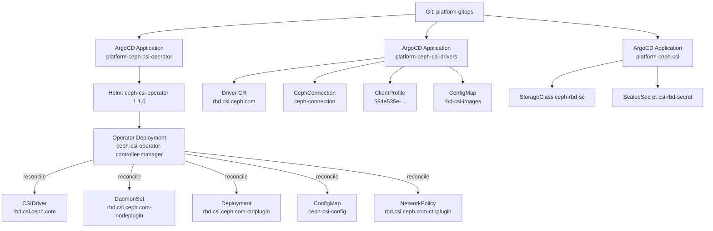

# 以 Ceph-CSI Operator 为例：Kubernetes Operator 工作原理详解

- **日期**：2026-11-09
- **集群**：`kubernetes-admin@kubernetes`（Kubernetes v1.35.9）
- **Operator**：`ceph-csi-operator` v1.1.0
- **Driver**：`rbd.csi.ceph.com`，Ceph-CSI `v3.18.2`
- **命名空间**：Operator 在 `ceph-csi-operator-system`，Driver/CR 在 `ceph-csi-rbd`

---

## 0. 先给结论

Operator 不是魔法，它本质上就是：

> **CRD（自定义 API）+ 一个长期运行的 controller 进程 + 不断对比“期望状态”和“实际状态”并修正的 reconcile 循环。**

用本集群的链路表示：

```
ArgoCD（GitOps）
  └── Helm chart：ceph-csi-operator 1.1.0
        └── Operator Deployment（controller-manager）
              └── watch Driver / CephConnection / ClientProfile
                    └── 创建/更新 CSIDriver、DaemonSet、Deployment、ConfigMap、NetworkPolicy
```

Helm 负责“把 Operator 装进来”，ArgoCD 负责“把 Git 里的期望状态同步进来”，Operator 负责“在运行期持续保证 Driver 的实际状态等于 CR 里声明的状态”。

---

## 1. 本集群的部署分层

### 1.1 三个 ArgoCD Application

| Application | 负责内容 |
|---|---|
| `platform-ceph-csi-operator` | Helm chart `ceph-csi-operator` 1.1.0：CRD、Operator Deployment、Operator RBAC |
| `platform-ceph-csi-drivers` | Helm chart `ceph-csi-drivers` 1.1.0：Driver、CephConnection、ClientProfile、驱动 SA/RBAC、imageSet ConfigMap |
| `platform-ceph-csi` | StorageClass `ceph-rbd-sc`、SealedSecret `csi-rbd-secret` |

三个应用都是 `Synced / Healthy`。

### 1.2 实际资源链路



### 1.3 一个容易误解的点：`helm list` 为空

```bash
helm list -n ceph-csi-operator-system
# NAME  NAMESPACE  REVISION  UPDATED  STATUS  CHART  APP VERSION
# （为空）
```

这不是没装 Helm，而是 **ArgoCD 用 Helm 渲染模板，但不创建 Helm release 记录**。资源上同时存在：

- Helm chart 标签：`helm.sh/chart: ceph-csi-operator-1.1.0`
- ArgoCD tracking：`argocd.argoproj.io/tracking-id: platform-ceph-csi-operator:...`

也就是说：**Helm 是渲染器，ArgoCD 是交付器，Operator 是运行期控制器**，三者职责不同。

---

## 2. Operator 的四个基本构件

| 构件 | 在本集群中的体现 |
|---|---|
| CRD | `drivers.csi.ceph.io`、`cephconnections.csi.ceph.io`、`clientprofiles.csi.ceph.io` 等 |
| CR | `Driver/rbd.csi.ceph.com`、`CephConnection/ceph-connection`、`ClientProfile/594e535e-...` |
| Controller/Manager | `ceph-csi-operator-controller-manager` Deployment 中的进程 |
| Reconcile | 监听 CR 变化，创建/更新 CSIDriver、DaemonSet、Deployment、ConfigMap 等 |

### 2.1 CRD 与 CR 的关系

- **CRD** 定义“可以创建什么类型的对象、字段 schema 是什么、是否有 status 子资源”。
- **CR** 是用户声明的“期望状态”，例如：

```yaml
apiVersion: csi.ceph.io/v1
kind: Driver
metadata:
  name: rbd.csi.ceph.com
  namespace: ceph-csi-rbd
spec:
  imageSet:
    name: rbd-csi-images
  controllerPlugin:
    replicas: 1
  fsGroupPolicy: File
```

- Operator 读取 CR 的 `spec`，创建/更新真实资源；可选地把观测结果写回 CR 的 `status`。

本集群的 `Driver` CRD：

```bash
kubectl get crd drivers.csi.ceph.io \
  -o jsonpath='{.spec.versions[*].name}'
# v1
```

`drivers.csi.ceph.io` 有 `status` 子资源，但当前 `Driver` 的 `status` 为空；`ClientProfile` 的 `status` 是：

```yaml
status:
  message: ClientProfile reconciled successfully
  phase: Ready
```

> 不同 controller 对 status 的填充程度不同；没有 status 不代表没工作，主要看它创建的下游资源。

---

## 3. 本集群的 CR 实例

### 3.1 CephConnection：连接信息

```yaml
apiVersion: csi.ceph.io/v1
kind: CephConnection
metadata:
  name: ceph-connection
  namespace: ceph-csi-rbd
spec:
  monitors:
    - 10.0.0.31:6789
    - 10.0.0.41:6789
    - 10.0.0.51:6789
```

它只描述“Ceph 集群在哪里”，不包含 secret。实际观测到它有一个 ownerReference 指向 `ClientProfile`：

```yaml
ownerReferences:
  - apiVersion: csi.ceph.io/v1
    kind: ClientProfile
    name: 594e535e-d82c-11f0-afa7-bc24112b746f
```

### 3.2 ClientProfile：集群配置 + secret 引用

```yaml
apiVersion: csi.ceph.io/v1
kind: ClientProfile
metadata:
  name: 594e535e-d82c-11f0-afa7-bc24112b746f
  namespace: ceph-csi-rbd
  finalizers:
    - csi.ceph.com/cleanup
spec:
  cephConnectionRef:
    name: ceph-connection
  rbd:
    cephCsiSecrets:
      controllerPublishSecret:
        name: csi-rbd-secret
        namespace: ceph-csi-rbd
      nodePublishSecret:
        name: csi-rbd-secret
        namespace: ceph-csi-rbd
status:
  message: ClientProfile reconciled successfully
  phase: Ready
```

**关键点：ClientProfile 的名字必须等于 StorageClass 的 `clusterID`。**

```yaml
# StorageClass ceph-rbd-sc
parameters:
  clusterID: 594e535e-d82c-11f0-afa7-bc24112b746f
```

CSI provisioner 用 `clusterID` 在 `ceph-csi-config` ConfigMap 中查找 monitors 和 secret 引用。名字对不上，就会找不到集群。

### 3.3 Driver：驱动部署规格

```yaml
apiVersion: csi.ceph.io/v1
kind: Driver
metadata:
  name: rbd.csi.ceph.com
  namespace: ceph-csi-rbd
spec:
  imageSet:
    name: rbd-csi-images
  fsGroupPolicy: File
  attachRequired: true
  snapshotPolicy: none
  controllerPlugin:
    replicas: 1
    hostNetwork: false
  nodePlugin:
    imagePullPolicy: IfNotPresent
  log:
    verbosity: 0
    rotation:
      maxFiles: 7
      maxLogSize: 10G
      periodicity: daily
```

它描述“我要一个 RBD CSI 驱动，用哪套镜像、几个 controller 副本、日志怎么轮转”，但不直接描述 Pod 模板。

### 3.4 OperatorConfig：全局默认值（本集群未创建）

```bash
kubectl get operatorconfig -A
# No resources found
```

OperatorConfig 用于给所有 Driver 设置默认值（例如全局 imageSet、日志、fencing）。本集群没有创建，Operator 使用内置默认值。

---

## 4. Operator 进程内部结构

### 4.1 实际 Deployment

```bash
kubectl -n ceph-csi-operator-system get deploy ceph-csi-operator-controller-manager
```

关键字段：

```yaml
image: quay.io/cephcsi/ceph-csi-operator:v1.1.0
args:
  - --leader-elect
env:
  - name: OPERATOR_NAMESPACE
    valueFrom:
      fieldRef:
        fieldPath: metadata.namespace
  - name: CSI_SERVICE_ACCOUNT_PREFIX
    value: ceph-csi-operator-
  - name: WATCH_NAMESPACE
    value: ceph-csi-rbd
  - name: KUBERNETES_CLUSTER_DOMAIN
    value: cluster.local
```

### 4.2 `WATCH_NAMESPACE` 是一个真实踩过的坑

第一次安装时 `WATCH_NAMESPACE` 为空，Operator 日志：

```
ERROR setup manager will only watch for resources in the operator deployed namespace
{"error": "WATCH_NAMESPACE must be set"}
```

结果：Driver CR 在 `ceph-csi-rbd`，Operator 却只 watch 自己的 `ceph-csi-operator-system`，所以完全没有创建驱动 Pod。

修正为 `WATCH_NAMESPACE=ceph-csi-rbd` 后，Operator 才开始 reconcile `ceph-csi-rbd` 里的 Driver。

### 4.3 controller-runtime 的核心组件

Ceph-CSI Operator 基于 `controller-runtime`，进程内大致有：

| 组件 | 作用 |
|---|---|
| Manager | 启动所有 controller、cache、metrics、leader election |
| Scheme | 注册 CRD 类型（Driver、CephConnection、ClientProfile 等） |
| Cache/Informer | 从 API Server watch 资源，维护本地缓存，减少直接 API 调用 |
| Client | 读写 API Server（创建/更新/删除资源） |
| Workqueue | 把“需要 reconcile 的对象 key（namespace/name）”排队，支持限速重试 |
| Reconciler | 真正的业务逻辑：对比期望状态和实际状态 |
| Leader election | 多副本时只有一个 active，避免重复 reconcile |
| Metrics | Prometheus 指标、健康检查端口 |

### 4.4 Leader election

Operator 以单副本运行，但仍然启用了 `--leader-elect`：

```bash
kubectl -n ceph-csi-operator-system get lease
# NAME                HOLDER
# 0a62cc8a.ceph.io    ceph-csi-operator-controller-manager-... 
```

Lease 保证即使未来扩到多副本，也只有一个实例在执行 reconcile。

### 4.5 Operator 的 RBAC：它能做什么、不能做什么

`ceph-csi-operator-manager-role` 的权限大致是：

| API Group | 资源 | 动作 |
|---|---|---|
| core | configmaps, services | create/delete/get/list/patch/update/watch |
| core | nodes | list/watch |
| apps | daemonsets, deployments | create/delete/get/list/patch/update/watch |
| csi.ceph.io | drivers, clientprofiles, cephconnections 等 | create/delete/get/list/patch/update/watch |
| csi.ceph.io | `*/status`, `*/finalizers` | get/patch/update |
| networking.k8s.io | networkpolicies | create/delete/get/list/patch/update/watch |
| storage.k8s.io | csidrivers | create/delete/get/list/patch/update/watch |

注意它**没有**：

- `secrets` 权限：Operator 不读取/复制 Ceph 密钥，驱动通过 StorageClass/PV 的 secret 引用自己去读。
- `storageclasses` 权限：StorageClass 由我们自己的 `platform-ceph-csi` Application 管理。
- RBAC 权限：驱动的 ServiceAccount/Role/ClusterRole 由 `ceph-csi-drivers` chart 创建，Operator 只引用这些 SA。

这是一个很好的最小权限设计：Operator 只管理“驱动运行所需的工作负载和配置”，不碰密钥和 RBAC。

---

## 5. 一次完整的 reconcile：以 Driver 为例

Operator 日志（节选，真实输出）：

```
Starting reconcile iteration for Ceph CSI driver
  {"Driver": {"name":"rbd.csi.ceph.com","namespace":"ceph-csi-rbd"}}
Reconciling CSI Config Map
  {"csiConfigMap": "ceph-csi-config"}
Reconciling logRotate configmap
  {"logRotateConfigMap": "rbd.csi.ceph.com-logrotate-config"}
Reconciling CSI Driver
  {"driverName": "rbd.csi.ceph.com"}
Reconciling node plugin deployment
  {"daemonSetName": "rbd.csi.ceph.com-nodeplugin"}
Reconciling controller plugin deployment
  {"deploymentName": "rbd.csi.ceph.com-ctrlplugin"}
Reconciling controller plugin network policy
  {"networkPolicy": "rbd.csi.ceph.com-ctrlplugin"}
Reconciling liveness service
  {"service": "rbd-csi-ceph-com-liveness"}
CSI Driver reconciliation completed successfully
```

### Step 1：触发

触发来源可以是：

- 创建/修改 `Driver` CR
- Operator 启动时列出所有 Driver
- 周期性 resync
- 我们手动加 annotation（例如 `csi.ceph.io/image-refresh`）
- 被 watch 的下游资源变化（Deployment/DaemonSet/ConfigMap 等）

> 实测：单纯改 `rbd-csi-images` ConfigMap 不一定会立刻触发 Driver reconcile；我们给 Driver 加了一个 `csi.ceph.io/image-refresh` annotation 强制触发了一次。这说明 watch 的 predicate 没有把“imageSet ConfigMap 变化”映射到 Driver。生产上可以用 annotation 或直接改 Driver spec 来触发。

### Step 2：从缓存读取 Driver

Reconciler 收到 `ceph-csi-rbd/rbd.csi.ceph.com`，从 informer cache 里拿到对象。如果对象已删除，直接返回，不做任何事。

### Step 3：解析 imageSet

Driver 的 `spec.imageSet.name = rbd-csi-images`，Operator 读取同 namespace 的 ConfigMap：

```yaml
data:
  plugin: quay.io/cephcsi/cephcsi:v3.18.2
  provisioner: registry.k8s.io/sig-storage/csi-provisioner:v6.3.0
  attacher: registry.k8s.io/sig-storage/csi-attacher:v4.13.0
  resizer: registry.k8s.io/sig-storage/csi-resizer:v2.2.1
  registrar: registry.k8s.io/sig-storage/csi-node-driver-registrar:v2.18.0
  snapshotter: registry.k8s.io/sig-storage/csi-snapshotter:v8.6.0
```

然后把镜像填进 DaemonSet/Deployment 的容器定义。

### Step 4：reconcile `ceph-csi-config` ConfigMap

Operator 把 `CephConnection` + `ClientProfile` 合成为 CSI 驱动能读的 `config.json`：

```json
[
  {
    "clusterID": "594e535e-d82c-11f0-afa7-bc24112b746f",
    "monitors": ["10.0.0.31:6789", "10.0.0.41:6789", "10.0.0.51:6789"],
    "rbd": {
      "controllerPublishSecretRef": {
        "name": "csi-rbd-secret",
        "namespace": "ceph-csi-rbd"
      },
      "nodePublishSecretRef": {
        "name": "csi-rbd-secret",
        "namespace": "ceph-csi-rbd"
      }
    }
  }
]
```

这个 ConfigMap 的 ownerReferences 同时指向 Driver 和 ClientProfile。

### Step 5：reconcile logrotate ConfigMap

生成 `rbd.csi.ceph.com-logrotate-config`，供 `log-rotator` sidecar 使用，对应 Driver 的：

```yaml
log:
  rotation:
    maxFiles: 7
    maxLogSize: 10G
    periodicity: daily
```

### Step 6：reconcile CSIDriver

创建/更新集群级对象：

```yaml
apiVersion: storage.k8s.io/v1
kind: CSIDriver
metadata:
  name: rbd.csi.ceph.com
  annotations:
    csi.ceph.io/ownerref: '{"Namespace":"ceph-csi-rbd","Name":"rbd.csi.ceph.com"}'
spec:
  attachRequired: true
  fsGroupPolicy: File
  podInfoOnMount: true
  requiresRepublish: false
  seLinuxMount: true
  storageCapacity: false
  volumeLifecycleModes:
    - Persistent
```

**为什么 CSIDriver 没有 ownerReference？**

因为 `CSIDriver` 是 cluster-scoped，而 `Driver` CR 是 namespaced。Kubernetes 不允许 namespaced owner 引用 cluster-scoped 对象。Operator 用 `csi.ceph.io/ownerref` annotation 记录“这个 CSIDriver 属于哪个 Driver”，删除 Driver 时由 Operator 自己清理。

### Step 7：reconcile nodeplugin DaemonSet

生成：

```text
DaemonSet: ceph-csi-rbd/rbd.csi.ceph.com-nodeplugin
  - csi-rbdplugin
  - driver-registrar
  - log-rotator
  hostNetwork: true
  updateStrategy:
    type: RollingUpdate
    rollingUpdate:
      maxSurge: 0
      maxUnavailable: 1
  ownerReference: Driver/rbd.csi.ceph.com
```

关键 host mounts：

```text
/dev
/sys
/run/mount
/lib/modules
/tmp/csi/keys
/csi
/etc/ceph-csi-config
/var/lib/kubelet/plugins
/var/lib/kubelet/pods
/run/secrets/tokens
/csi-logs
```

`maxSurge: 0 / maxUnavailable: 1` 表示逐节点滚动：先停一个节点的旧 Pod，再起新 Pod。

### Step 8：reconcile ctrlplugin Deployment

生成：

```text
Deployment: ceph-csi-rbd/rbd.csi.ceph.com-ctrlplugin
  replicas: 1
  strategy: Recreate
  containers:
    - csi-rbdplugin
    - csi-provisioner
    - csi-resizer
    - csi-attacher
    - log-rotator
  ownerReference: Driver/rbd.csi.ceph.com
```

注意这里是 `Recreate` 而不是 RollingUpdate：单副本 controller 升级时会有短暂的中断，新的 PVC provisioning 在几秒内不可用。

### Step 9：reconcile NetworkPolicy / Service

- 生成 `NetworkPolicy/rbd.csi.ceph.com-ctrlplugin`，ownerReference 指向 Driver。
- 日志里出现 `liveness service`，但本集群 `kubectl -n ceph-csi-rbd get svc` 为空；因为 Driver 没有配置 liveness 端口/相关字段，Operator 没有实际创建 Service。这体现了“reconcile 逻辑会检查条件，不是每次都创建”。

### Step 10：状态与幂等

日志里的 “is already up to date” 表示 Operator 对比了期望和实际，发现一致，不做写入。

如果手动改坏了 DaemonSet（例如改镜像、改挂载），下一次 reconcile 会把它们改回 Driver 声明的状态。这就是 Operator 和 Helm 最大的区别：**Helm 只在 install/upgrade 时生效，Operator 在运行期持续纠偏。**

---

## 6. CephConnection / ClientProfile 的协调

### 6.1 最终产物

| CR | 作用 | 被谁消费 |
|---|---|---|
| `CephConnection` | monitors | Operator 生成 `ceph-csi-config` |
| `ClientProfile` | clusterID、RBD secret 引用、CephFS 配置 | Operator 生成 `ceph-csi-config`；StorageClass 的 `clusterID` 对齐 |
| `Driver` | 驱动部署规格、imageSet | Operator 生成 DS/Deployment/CSIDriver 等 |

### 6.2 clusterID 的三方对齐

```
ClientProfile.metadata.name
        ==
StorageClass.parameters.clusterID
        ==
ceph-csi-config.config.json[].clusterID
```

本集群三者都是：

```
594e535e-d82c-11f0-afa7-bc24112b746f
```

### 6.3 Secret 的处理

- Operator 的 RBAC **不包含 secrets**。
- `csi-rbd-secret` 由 SealedSecret 管理，保留在 `ceph-csi-rbd`。
- ClientProfile 只记录 secret 的 name/namespace；驱动在 provision/attach/mount 时根据 StorageClass/PV 的 secret 引用去读取。
- 现有 PV 的 `nodeStageSecretRef` / `controllerExpandSecretRef` 是不可变的，所以 secret 必须继续留在 `ceph-csi-rbd`。

### 6.4 Finalizer 与级联删除

`ClientProfile` 有：

```yaml
finalizers:
  - csi.ceph.com/cleanup
```

删除 ClientProfile 时，Operator 会先执行清理逻辑，再移除 finalizer，对象才真正消失。

`CephConnection` 的 ownerReference 指向 `ClientProfile`，所以删除 ClientProfile 会级联删除 CephConnection。

---

## 7. 生命周期：创建、漂移、升级、删除、失败

### 7.1 创建

```bash
kubectl apply -f Driver.yaml
kubectl apply -f CephConnection.yaml
kubectl apply -f ClientProfile.yaml
```

Operator 收到 watch 事件 → 入队 → reconcile → 创建 CSIDriver/DS/Deployment/ConfigMap/NetworkPolicy。

### 7.2 漂移

| 手动操作 | Operator 行为 |
|---|---|
| 改 DaemonSet 镜像 | 下一次 reconcile 改回 Driver/imageSet 指定镜像 |
| 删掉 ctrlplugin Deployment | 重新创建 |
| 改 `ceph-csi-config` | 重新生成 |
| 改 CSIDriver 字段 | 重新更新 |
| 改 Driver CR | 按新 spec reconcile |

### 7.3 升级

本集群的升级路径：

1. 改 `platform-ceph-csi-operator` 的 chart 版本（Operator 自身）。
2. 改 `rbd-csi-images` ConfigMap 里的镜像 tag。
3. 触发 Driver reconcile（改 Driver annotation 或 spec）。
4. Operator 更新 DS/Deployment → 滚动/重建 → 新驱动生效。

本次从 `v3.18.2-rocky9` 切到 `v3.18.2` 就是通过改 imageSet + 给 Driver 加 annotation 完成的。

### 7.4 删除

删除 `Driver/rbd.csi.ceph.com`：

- namespaced 资源（DS、Deployment、ConfigMap、NetworkPolicy）通过 ownerReference 被 Kubernetes GC 删除。
- cluster-scoped `CSIDriver` 不能靠 ownerReference，由 Operator 根据 `csi.ceph.io/ownerref` annotation 清理。
- `ClientProfile` 的 finalizer 保证清理顺序。
- `StorageClass` 和 `Secret` 不归 Operator 管，保留。

### 7.5 失败与重试

- Reconciler 返回 error → 对象重新入队，按指数退避重试。
- 冲突（例如 `the object has been modified`）→ 重新取最新对象再试。
- Leader election 失败 → 另一个副本接管。
- 常见失败会记录在 Operator 日志和 Kubernetes Event 中。

---

## 8. Operator 与 Helm / ArgoCD 的分工

| 层 | 负责 | 本集群体现 |
|---|---|---|
| Helm | 打包、模板、安装 Operator/CRD/RBAC | `ceph-csi-operator` chart 1.1.0 |
| ArgoCD | GitOps 同步、漂移检测、应用编排 | 三个 `platform-ceph-csi-*` Application |
| Operator | 运行期 reconcile、生命周期、配置分发 | `ceph-csi-operator-controller-manager` |
| CR | 声明 Driver/Connection/Profile 的期望状态 | `Driver`、`CephConnection`、`ClientProfile` |
| CSI Driver | 实际数据路径：provision/attach/mount | `csi-rbdplugin` 等容器 |

一句话：**Helm 装 Operator，Operator 管 Driver，Driver 管存储 I/O。**

---

## 9. 为什么 CSI 适合 Operator，以及 Operator 不做什么

### 9.1 适合的原因

- 节点级 DaemonSet + 控制器 Deployment 的升级顺序复杂。
- 配置需要从 CephConnection/ClientProfile 动态合成，而不是静态 values。
- 多 Ceph 集群、多 driver、imageSet、snapshot policy、日志轮转等需要持续协调。
- 需要漂移修复和状态上报。
- 需要在不重新 Helm install 的情况下升级驱动镜像。

### 9.2 Operator 不做什么

- 不处理数据路径 I/O（由内核 RBD + CSI 驱动完成）。
- 不管理 Ceph 集群本身（monitor/OSD/pool）。
- 不创建/管理 Ceph 密钥（Secret 由 SealedSecret 管理）。
- 不管理 StorageClass（本集群由 `platform-ceph-csi` Application 管理）。
- 不负责 GitOps（ArgoCD 负责）。

---

## 10. 本集群排障手册

### 10.1 看 Operator

```bash
kubectl -n ceph-csi-operator-system get deploy,pods
kubectl -n ceph-csi-operator-system logs deploy/ceph-csi-operator-controller-manager -f
kubectl -n ceph-csi-operator-system get lease
```

### 10.2 看 CR 状态

```bash
kubectl -n ceph-csi-rbd get driver,cephconnection,clientprofile
kubectl -n ceph-csi-rbd get driver rbd.csi.ceph.com -o yaml
kubectl -n ceph-csi-rbd get clientprofile 594e535e-... -o yaml
```

### 10.3 看生成资源

```bash
kubectl -n ceph-csi-rbd get ds,deploy,cm,networkpolicy,sa
kubectl get csidriver rbd.csi.ceph.com -o yaml
kubectl -n ceph-csi-rbd get cm ceph-csi-config -o yaml
```

### 10.4 强制触发 reconcile

```bash
kubectl -n ceph-csi-rbd annotate driver rbd.csi.ceph.com \
  csi.ceph.io/image-refresh="$(date +%s)" --overwrite
```

### 10.5 本次实际踩过的坑

| 问题 | 现象 | 根因 | 处理 |
|---|---|---|---|
| `WATCH_NAMESPACE` 为空 | Driver CR 存在但无驱动 Pod | Operator 只 watch 自己 namespace | 设为 `ceph-csi-rbd` |
| 3.18.2 镜像崩溃 | `CPU does not support x86-64-v3` | VM CPU 是 v2 | 先 rocky9，后 VM 改 v3，再切回标准镜像 |
| 改 imageSet 不生效 | DS/Deployment 镜像不变 | ConfigMap 变化未触发 Driver reconcile | 给 Driver 加 annotation 强制 reconcile |
| worker DiskPressure | CSI nodeplugin 被驱逐 | 镜像/日志占满磁盘 | `crictl rmi --prune` + 必要时重启 kubelet |

---

## 11. 总结

1. **Operator = CRD + controller + reconcile**，不是新魔法。
2. **Helm 和 Operator 不是替代关系**：Helm 负责安装，Operator 负责运行期生命周期。
3. **本集群链路**：Git → ArgoCD → Helm chart → Operator → CR → 真实资源 → CSI 驱动。
4. **CR 是期望状态**，Operator 持续把实际状态拉回期望状态，这是它和一次性 Helm 渲染的根本区别。
5. **Ceph-CSI 的例子**很好地展示了 Operator 的价值：Driver/CephConnection/ClientProfile 三个 CR，最终生成 CSIDriver、DaemonSet、Deployment、ConfigMap、NetworkPolicy，并处理升级、漂移、删除和跨 namespace 的 secret 约束。
6. **Operator 不是银弹**：它带来 CRD/状态/调试/权限等复杂度。无状态、简单的组件用 Helm 或 Helm + CRD 就够了；有状态、需要持续协调的基础设施，才值得上 Operator。
