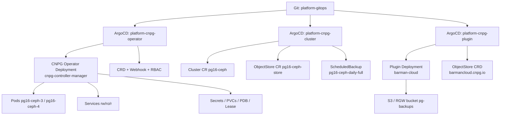

# 以 CloudNativePG 为例：PostgreSQL Operator 工作原理与实战教程

- **日期**：2026-11-09
- **集群**：`kubernetes-admin@kubernetes`（Kubernetes v1.35.9）
- **Operator**：CloudNativePG `1.30.1`
- **PostgreSQL**：`16.15`
- **集群 CR**：`pg16-ceph`（2 实例）
- **命名空间**：`cnpg-system`
- **GitOps**：ArgoCD Application + `platform-gitops` 仓库中的 raw manifests

> **2026-11-10 更新**：`pg-secret`、`pg-superuser-secret`、`pg-backup-s3-creds` 已用 SealedSecret 纳入 GitOps；2026-11-10 02:00 的 daily full 备份已成功。

---

## 0. 先给结论

CNPG 和 Ceph-CSI Operator 遵循同一个模式，但关注点不同：

> **Ceph-CSI Operator 管的是“存储驱动怎么部署”；CNPG Operator 管的是“PostgreSQL 集群怎么运行”。**

CNPG 的核心是：

```
Cluster CR（期望状态）
   ↓
CNPG Operator（controller + webhook）
   ↓
Pods / Services / Secrets / PVCs / PDB / Leases
   ↓
每个 Pod 内的 Instance Manager 控制 PostgreSQL 进程
   ↓
barman-cloud Plugin Sidecar 负责 WAL 归档和备份
```

它不只是“把 PostgreSQL 装起来”，而是持续处理：

- 主从复制、故障转移、switchover
- Service 指向正确的 primary/replica
- 备份、WAL 归档、保留策略
- 证书轮换
- 升级、重启、PVC 扩缩
- 状态上报和条件（conditions）

---

## 1. 本集群的部署分层

### 1.1 三个 ArgoCD Application

| Application | Git 路径 | 内容 |
|---|---|---|
| `platform-cnpg-operator` | `platform/cnpg/operator` | 上游 all-in-one 清单 `cnpg-1.30.1.yaml`：CRD、RBAC、Deployment、Webhook |
| `platform-cnpg-cluster` | `platform/cnpg/cluster` | `Cluster`、`ObjectStore`、`ScheduledBackup` |
| `platform-cnpg-plugin` | `platform/cnpg/plugin` | `plugin-barman-cloud-0.15.1.yaml`：ObjectStore CRD、Plugin Deployment、RBAC |

三个应用都是 `Synced / Healthy`。

> 与 Ceph-CSI 不同，CNPG 这里是 **raw manifests / directory source**，不是 Helm chart。ArgoCD 直接同步 YAML。

### 1.2 实际资源链路



---

## 2. CNPG 的架构：Operator + Instance Manager + Plugin

### 2.1 Operator 负责“集群级”决策

- watch `Cluster`、`Backup`、`ScheduledBackup`、`Pooler`、`Database` 等 CR
- 创建/更新 Pod、Service、Secret、PVC、PDB
- 决定谁是 primary、谁需要 promote/demote
- 处理滚动升级、switchover、证书轮换
- 调用 Instance Manager 的 HTTP API 执行具体操作

### 2.2 Instance Manager 负责“实例级”操作

每个 PostgreSQL Pod 的 `postgres` 容器里运行的不是普通的 `postgres` 进程，而是：

```
/controller/manager instance run --status-port-tls --log-level=info
```

这个 **instance manager**：

- 启动/停止/监控 PostgreSQL
- 暴露 `:8000` 状态端口（`/healthz`、`/readyz`、`/startupz`）
- 暴露 `:9187` metrics
- 执行 promote/demote、备份、restore、pg_rewind 等
- 与 Operator 通过 HTTPS API 通信

### 2.3 Plugin 负责“扩展能力”

本集群启用了 `barman-cloud.cloudnative-pg.io` 插件：

```yaml
plugins:
  - name: barman-cloud.cloudnative-pg.io
    enabled: true
    isWALArchiver: true
    parameters:
      barmanObjectName: pg16-ceph-store
      serverName: pg16-ceph
```

插件有两个运行时组件：

| 组件 | 位置 | 作用 |
|---|---|---|
| `barman-cloud` Deployment | `cnpg-system`，`:9090` | 插件生命周期服务，管理 ObjectStore 和 sidecar 注入 |
| `plugin-barman-cloud` sidecar | 每个 PostgreSQL Pod 内 | 执行 WAL 归档、base backup、恢复 |

`Cluster.status.pluginStatus` 也验证了插件的三个能力：

```
TYPE_RECONCILER_HOOKS
TYPE_LIFECYCLE_SERVICE
TYPE_INSTANCE_SIDECAR_INJECTION
version: 0.15.1
```

---

## 3. CRD 与 CR

### 3.1 CNPG 主要 CRD

```bash
kubectl get crd | grep cnpg.io
```

本集群包含：

| CRD | 作用 |
|---|---|
| `clusters.postgresql.cnpg.io` | PostgreSQL 集群 |
| `backups.postgresql.cnpg.io` | 一次性备份 |
| `scheduledbackups.postgresql.cnpg.io` | 定时备份 |
| `poolers.postgresql.cnpg.io` | PgBouncer 连接池 |
| `databases.postgresql.cnpg.io` | 声明式数据库 |
| `databaseroles.postgresql.cnpg.io` | 声明式角色 |
| `publications/subscriptions` | 逻辑复制 |
| `failoverquorums.postgresql.cnpg.io` | 故障转移仲裁 |
| `clusterimagecatalogs/imagecatalogs` | 镜像目录 |
| `objectstores.barmancloud.cnpg.io` | 插件提供的 S3 对象存储配置 |

### 3.2 本集群的 CR

```bash
kubectl -n cnpg-system get cluster,backup,scheduledbackup,objectstore
```

| 资源 | 名称 |
|---|---|
| Cluster | `pg16-ceph` |
| ObjectStore | `pg16-ceph-store` |
| ScheduledBackup | `pg16-ceph-daily-full` |

---

## 4. Cluster CR 详解

本集群的 `Cluster` 关键字段：

```yaml
apiVersion: postgresql.cnpg.io/v1
kind: Cluster
metadata:
  name: pg16-ceph
  namespace: cnpg-system
spec:
  instances: 2
  imageName: ghcr.io/cloudnative-pg/postgresql:16.15

  storage:
    size: 10Gi
    storageClass: ceph-rbd-sc
  walStorage:
    size: 5Gi
    storageClass: ceph-rbd-sc

  resources:
    requests:
      cpu: 500m
      memory: 1Gi
    limits:
      cpu: "1"
      memory: 2Gi

  bootstrap:
    initdb:
      database: n8n
      owner: n8nuser
      secret:
        name: pg-secret

  backup:
    target: prefer-standby

  plugins:
    - name: barman-cloud.cloudnative-pg.io
      enabled: true
      isWALArchiver: true
      parameters:
        barmanObjectName: pg16-ceph-store
        serverName: pg16-ceph

  primaryUpdateMethod: switchover
  primaryUpdateStrategy: unsupervised
  enablePDB: true
```

### 4.1 字段解释

| 字段 | 含义 |
|---|---|
| `instances` | 实例数；本集群 2 个 |
| `imageName` | PostgreSQL 镜像 |
| `storage` / `walStorage` | 数据卷和 WAL 卷，均使用 `ceph-rbd-sc` |
| `bootstrap.initdb` | 首次初始化数据库、用户、密码 secret |
| `backup.target: prefer-standby` | 优先在 standby 上做备份 |
| `plugins` | 启用 barman-cloud 插件，指定 ObjectStore |
| `primaryUpdateMethod: switchover` | 主库更新时用 switchover，而不是原地重启 |
| `primaryUpdateStrategy: unsupervised` | Operator 自动执行 switchover |
| `enablePDB` | 自动创建 primary 的 PDB |

### 4.2 Status 实际内容

```bash
kubectl -n cnpg-system get cluster pg16-ceph -o yaml
```

关键 status：

```yaml
status:
  phase: Cluster in healthy state
  currentPrimary: pg16-ceph-3
  targetPrimary: pg16-ceph-3
  instances: 2
  readyInstances: 2
  writeService: pg16-ceph-rw
  readService: pg16-ceph-r
  healthyPVC:
    - pg16-ceph-3
    - pg16-ceph-3-wal
    - pg16-ceph-4
    - pg16-ceph-4-wal
  instancesReportedState:
    pg16-ceph-3:
      isPrimary: true
      timeLineID: 20
    pg16-ceph-4:
      isPrimary: false
      timeLineID: 20
  lastSuccessfulBackup: "2026-11-08T10:19:32Z"
  lastFailedBackup: "2026-11-09T02:00:02Z"
  firstRecoverabilityPoint: "2026-10-09T02:00:13Z"
```

Conditions：

```text
Ready=True                  ClusterIsReady
ContinuousArchiving=True    ContinuousArchivingSuccess
LastBackupSucceeded=True    LastBackupSucceeded
Initialized=True            BootstrapCompleted
ConsistentSystemID=True     Unique
```

---

## 5. Operator 进程内部

### 5.1 实际 Deployment

```yaml
image: ghcr.io/cloudnative-pg/cloudnative-pg:1.30.1
args:
  - controller
  - --leader-elect
  - --max-concurrent-reconciles=10
  - --config-map-name=cnpg-controller-manager-config
  - --secret-name=cnpg-controller-manager-config
  - --webhook-port=9443
env:
  - OPERATOR_IMAGE_NAME=ghcr.io/cloudnative-pg/cloudnative-pg:1.30.1
  - OPERATOR_NAMESPACE (fieldRef)
  - MONITORING_QUERIES_CONFIGMAP=cnpg-default-monitoring
```

### 5.2 三个 Lease

| Lease | Holder | 作用 |
|---|---|---|
| `db9c8771.cnpg.io` | `cnpg-controller-manager-...` | Operator 自身 leader election |
| `pg16-ceph` | `pg16-ceph-3` | PostgreSQL 主库 leader election |
| `822e3f5c.cnpg.io` | `barman-cloud-...` | barman-cloud 插件 lifecycle 服务 leader election |

`pg16-ceph` Lease 的 holder 是当前 primary：

```yaml
spec:
  holderIdentity: pg16-ceph-3
  leaseDurationSeconds: 15
  leaseTransitions: 7
```

### 5.3 Webhook

CNPG 安装了两个 webhook：

```text
mutatingwebhookconfiguration/cnpg-mutating-webhook-configuration
validatingwebhookconfiguration/cnpg-validating-webhook-configuration
service/cnpg-webhook-service  ->  :9443
```

作用：

- **Defaulting**：给 Cluster/Backup 补默认字段（如 `enablePDB`、`probes`、`replicationSlots` 等）
- **Validation**：校验不可变字段、非法配置、备份参数等

Operator 日志里可以看到：

```
Defaulting for Backup
Validation for Backup upon creation
Defaulting for Cluster
```

### 5.4 RBAC：CNPG 的权限比 Ceph-CSI 大得多

`cnpg-manager` ClusterRole 的关键规则：

| 资源 | 权限 |
|---|---|
| `configmaps`, `secrets`, `services` | create/delete/get/list/patch/update/watch |
| `pods`, `pods/exec`, `pvc` | create/delete/get/list/patch/watch |
| `deployments` | create/delete/get/list/patch/update/watch |
| `poddisruptionbudgets` | create/delete/get/list/patch/update/watch |
| `clusters/backups/scheduledbackups/...` | 全生命周期 |
| `cluster*/status`, `*/finalizers` | get/patch/update |
| `roles`, `rolebindings` | create/get/list/patch/update/watch |
| `volumesnapshots` | create/get/list/patch/watch |
| `mutating/validatingwebhookconfigurations` | get/patch |
| `leases` | create/get/list/update/watch |
| `endpointslices` | get/list/watch |
| `events` | create/patch |

为什么 CNPG 需要 **secrets** 和 **pods/exec**？

- 它要创建/更新数据库用户密码、TLS 证书、复制凭据。
- 它需要通过 `pods/exec` 或 instance manager API 执行 `pg_rewind`、promote、basebackup 等操作。
- 它要管理 PVC、PDB、Service，保证集群可用性。

这也是 Operator 权限模型需要重点关注的地方：**CNPG Operator 基本等于一个“数据库 DBA + Kubernetes 管理员”的组合**。

---

## 6. 一次 reconcile 的完整过程

以 `Cluster/pg16-ceph` 为例，Operator 大致会：

### Step 1：读取 Cluster 和默认值

- 从 cache 读取 `Cluster`。
- Webhook 已经补齐默认值（`enablePDB`、`probes`、`startDelay` 等）。
- 校验 spec。

### Step 2：确保基础资源

创建/更新：

- `Secret/pg16-ceph-ca`、`pg16-ceph-server`、`pg16-ceph-replication`（TLS）
- `Service/pg16-ceph-rw`（primary）
- `Service/pg16-ceph-ro`（read-only replicas）
- `Service/pg16-ceph-r`（any instance）
- `ServiceAccount/pg16-ceph`
- `PDB/pg16-ceph-primary`（`enablePDB: true`）

> `cnpg-controller-manager-config` 是 Operator 安装时提供的自身配置，不属于单个 Cluster 的 reconcile 产物。

### Step 3：确保实例 Pod

CNPG **不用 StatefulSet**，而是直接管理 Pod：

```text
pg16-ceph-3
pg16-ceph-4
```

每个 Pod 包含：

```text
containers:
  postgres
initContainers:
  bootstrap-controller
  plugin-barman-cloud   # restartPolicy: Always，原生 sidecar
```

Pod 命名规则：`<cluster>-<serial>`，serial 递增。

### Step 4：确保 PVC

```text
pg16-ceph-3      10Gi  ceph-rbd-sc
pg16-ceph-3-wal   5Gi  ceph-rbd-sc
pg16-ceph-4      10Gi  ceph-rbd-sc
pg16-ceph-4-wal   5Gi  ceph-rbd-sc
```

PVC 上有 CNPG 标签/注解：

```yaml
labels:
  cnpg.io/cluster: pg16-ceph
  cnpg.io/instanceName: pg16-ceph-3
  cnpg.io/instanceRole: primary
  cnpg.io/pvcRole: PG_DATA
annotations:
  cnpg.io/nodeSerial: "3"
  cnpg.io/operatorVersion: 1.30.1
  cnpg.io/pvcStatus: ready
```

### Step 5：启动/配置 PostgreSQL

- `bootstrap-controller` 在首次启动时执行 `initdb`，创建 `n8n` 数据库和 `n8nuser`。
- `postgres` 容器启动 instance manager，管理 PostgreSQL 进程。
- `plugin-barman-cloud` sidecar 启动，负责 WAL 归档。

### Step 6：主从判定

- instance manager 上报状态到 Operator。
- Operator 决定 primary/replica。
- 当前：

```text
pg16-ceph-3 -> primary   (timeline 20)
pg16-ceph-4 -> replica   (timeline 20)
```

### Step 7：Service 指向

- `pg16-ceph-rw` → 当前 primary（`pg16-ceph-3`）
- `pg16-ceph-ro` → replicas
- `pg16-ceph-r` → 任意实例

应用程序应该连 `pg16-ceph-rw` 做写，连 `pg16-ceph-ro` 做只读。

### Step 8：更新 status

Operator 更新：

- `currentPrimary`
- `instancesReportedState`
- `healthyPVC`
- `conditions`（Ready、ContinuousArchiving、LastBackupSucceeded 等）
- `lastSuccessfulBackup`、`lastFailedBackup`
- `pluginStatus`

---

## 7. Pod 内部：2/2 是怎么来的

```bash
kubectl -n cnpg-system get pod pg16-ceph-3
# NAME          READY   STATUS    RESTARTS   AGE
# pg16-ceph-3   2/2     Running   0          126m
```

`READY 2/2` 不是两个普通容器，而是：

| 容器 | 类型 | 作用 |
|---|---|---|
| `postgres` | 普通容器 | 运行 instance manager + PostgreSQL |
| `plugin-barman-cloud` | **原生 sidecar**（init container + `restartPolicy: Always`） | WAL 归档、备份 |
| `bootstrap-controller` | 普通 init container | 首次 initdb/recovery，执行完退出 |

`postgres` 容器端口：

| 端口 | 用途 |
|---|---|
| 5432 | PostgreSQL |
| 9187 | metrics |
| 8000 | instance manager status（HTTPS） |

探针：

```yaml
livenessProbe:  /healthz  :8000
readinessProbe: /readyz   :8000
startupProbe:   /startupz :8000
```

Pod 标签：

```yaml
cnpg.io/cluster: pg16-ceph
cnpg.io/instanceName: pg16-ceph-3
cnpg.io/instanceRole: primary
cnpg.io/podRole: instance
role: primary
```

Pod 注解：

```yaml
cnpg.io/nodeSerial: "3"
cnpg.io/operatorVersion: 1.30.1
cnpg.io/podEnvHash: d474b9d98
cnpg.io/podSpec: "{...完整 spec...}"
```

`cnpg.io/podSpec` 是 Operator 用于检测 Pod 模板漂移的关键：它把期望的 Pod spec 哈希/内容写在注解里，Pod 被手工改动后可以对比出来。

---

## 8. 主从、故障转移与 switchover

### 8.1 当前拓扑

```text
pg16-ceph-3 (worker03)  primary   timeline 20
pg16-ceph-4 (worker02)  replica   timeline 20
```

服务：

```text
pg16-ceph-rw -> pg16-ceph-3
pg16-ceph-ro -> pg16-ceph-4
pg16-ceph-r  -> 任意
```

### 8.2 复制模式

本集群：

```yaml
minSyncReplicas: 0
maxSyncReplicas: 0
```

即 **异步复制**：

- 主库提交事务后不必等 replica 确认。
- 主库故障时，可能丢失最近少量事务（RPO > 0）。
- 2 实例也没有 sync replica 的 quorum 优势。

生产上通常建议：

- `instances: 3`
- `minSyncReplicas: 1`（至少一个同步副本）
- 配合 anti-affinity 分散到不同节点

### 8.3 故障转移（failover）

当 primary 挂掉：

1. Operator 通过 Lease/Pod 状态检测到 primary 不可用。
2. 选择一个最新的 replica。
3. 通过 instance manager promote 成新 primary。
4. 更新 `pg16-ceph-rw` Service 指向新 primary。
5. 旧 primary 恢复后，通过 `pg_rewind` 重新加入作为 replica。
6. `pg16-ceph` Lease 的 holder 更新。

我们做 CPU 迁移时实际触发过两次：

```bash
kubectl -n cnpg-system delete pod pg16-ceph-3   # 主库 worker01 -> 触发 failover
# primary 变成 pg16-ceph-4

kubectl -n cnpg-system delete pod pg16-ceph-4   # 主库 worker02 -> 触发 failover
# primary 变回 pg16-ceph-3
```

每次等待：

```text
Cluster in healthy state
primary=pg16-ceph-4
ready=2/2
```

### 8.4 switchover

`primaryUpdateMethod: switchover` 表示升级主库时：

- 先选一个 replica；
- 主动 promote；
- 旧 primary 变成 replica；
- 再滚动更新旧 primary。

这比“直接重启主库”更平滑，但仍然是**计划内切换**，会有短暂写入中断。

### 8.5 PDB

```bash
kubectl -n cnpg-system get pdb
# pg16-ceph-primary   minAvailable 1   allowed disruptions 0
```

PDB 只选择 `cnpg.io/instanceRole=primary` 的 Pod。`allowed disruptions 0` 表示**不能通过 eviction 驱逐 primary**。

这就是为什么在 `kubectl drain` 之前必须先做 failover：否则 drain 会卡在 PDB 上。我们 CPU 迁移时就是这么处理的。

---

## 9. 备份与恢复

### 9.1 ObjectStore

```yaml
apiVersion: barmancloud.cnpg.io/v1
kind: ObjectStore
metadata:
  name: pg16-ceph-store
  namespace: cnpg-system
spec:
  retentionPolicy: "30d"
  configuration:
    destinationPath: s3://pg-backups/
    endpointURL: http://10.0.0.31:7480
    s3Credentials:
      accessKeyId:
        name: pg-backup-s3-creds
        key: ACCESS_KEY_ID
      secretAccessKey:
        name: pg-backup-s3-creds
        key: ACCESS_SECRET_KEY
    wal:
      compression: gzip
      maxParallel: 2
    data:
      compression: gzip
      jobs: 2
```

这是 Ceph RGW 提供的 S3 兼容存储。

### 9.2 插件如何工作

```text
Cluster.spec.plugins
  name: barman-cloud.cloudnative-pg.io
  isWALArchiver: true
  parameters:
    barmanObjectName: pg16-ceph-store
    serverName: pg16-ceph
```

- `barman-cloud` Deployment 是插件的 lifecycle 服务，负责注入 sidecar、管理 ObjectStore。
- 每个 PostgreSQL Pod 的 `plugin-barman-cloud` sidecar 执行：
  - 持续 WAL 归档（`archive_mode=on`）
  - base backup
  - restore
- 备份目标是 `ObjectStore/pg16-ceph-store`。

### 9.3 ScheduledBackup

```yaml
apiVersion: postgresql.cnpg.io/v1
kind: ScheduledBackup
metadata:
  name: pg16-ceph-daily-full
  namespace: cnpg-system
spec:
  backupOwnerReference: self
  cluster:
    name: pg16-ceph
  immediate: true
  schedule: "0 0 2 * * *"
  method: plugin
  pluginConfiguration:
    name: barman-cloud.cloudnative-pg.io
```

每天 02:00 执行一次全量 base backup。

`backupOwnerReference: self` 很重要：生成的 `Backup` 会归 `ScheduledBackup` 所有。注意：`plugin` 方式下，备份状态主要更新到 `ObjectStore.status`，`Cluster.status.lastSuccessfulBackup` 可能只反映 `barmanObjectStore` 方式的备份。

### 9.4 备份状态

```bash
kubectl -n cnpg-system get backup --sort-by=.metadata.creationTimestamp
kubectl -n cnpg-system get cluster pg16-ceph -o yaml
```

本集群：

- `ContinuousArchiving=True`：WAL 归档正常。
- 历史 daily full 大多 `barmanObjectStore` 方式成功。
- `2026-11-09 02:00` 的 daily full 以 `plugin` 方式失败（`rpc error: exit status 1`）。
- 手动 `Backup/pg16-ceph-check-20261109` **completed**，在 standby `pg16-ceph-4` 上执行。
- `2026-11-10 02:00` 的 daily full `pg16-ceph-daily-full-20261110020000` 已 **completed**（plugin）。
- `ObjectStore.status.serverRecoveryWindow` 已更新：

```yaml
pg16-ceph:
  firstRecoverabilityPoint: "2026-10-11T02:00:12Z"
  lastSuccessfulBackupTime: "2026-11-10T02:00:13Z"
  lastFailedBackupTime: "2026-11-09T02:00:02Z"
```

### 9.5 一个容易踩的坑：plugin 备份不一定更新 Cluster 的 lastSuccessfulBackup

无论是手动 `Backup` 还是 `ScheduledBackup`，只要使用 `method: plugin`，备份完成后：

- `ObjectStore.status.serverRecoveryWindow` 会更新；
- `Cluster.status.conditions` 的 `LastBackupSucceeded` 会更新；
- 但 `Cluster.status.lastSuccessfulBackup` / `lastSuccessfulBackupByMethod` 可能仍停留在最近一次 `barmanObjectStore` 备份。

本集群实测：

- 2026-11-09 手动 Backup completed；
- 2026-11-10 02:00 ScheduledBackup completed；
- `ObjectStore.status.serverRecoveryWindow.lastSuccessfulBackupTime` = `2026-11-10T02:00:13Z`；
- 但 `Cluster.status.lastSuccessfulBackup` 仍是 `2026-11-08T10:19:32Z`，`lastSuccessfulBackupByMethod` 只有 `barmanObjectStore`。

结论：使用 plugin 备份时，**不要只看 `Cluster.status.lastSuccessfulBackup`**，应以 `ObjectStore.status.serverRecoveryWindow` 和 `LastBackupSucceeded` condition 为准。

生产上如果要统一监控，可以：

- 监控 `ObjectStore.status.serverRecoveryWindow.lastSuccessfulBackupTime`；
- 监控 `Cluster.status.conditions` 里的 `LastBackupSucceeded`；
- 给 `ScheduledBackup` 的失败/延迟加告警。

### 9.6 恢复

本集群的 `Cluster` 目前只有 `bootstrap.initdb`，没有配置恢复。

如果要恢复，通常新建一个 Cluster，使用：

```yaml
spec:
  bootstrap:
    recovery:
      source: pg16-ceph
  externalClusters:
    - name: pg16-ceph
      plugin:
        name: barman-cloud.cloudnative-pg.io
        parameters:
          barmanObjectName: pg16-ceph-store
          serverName: pg16-ceph
```

建议在独立 namespace 做一次恢复演练，不要直接覆盖生产 Cluster。

---

## 10. GitOps 细节（本集群）

### 10.1 raw manifests

```text
platform/cnpg/operator/cnpg-1.30.1.yaml
platform/cnpg/cluster/cluster.yaml
platform/cnpg/cluster/objectstore.yaml
platform/cnpg/cluster/scheduledbackup.yaml
platform/cnpg/plugin/plugin-barman-cloud-0.15.1.yaml
```

三个 ArgoCD Application 都是 directory source，直接同步 YAML。

### 10.2 Operator 回填字段与 ignoreDifferences

CNPG Operator 会往 `Cluster.spec` 回填大量默认值：

```text
enablePDB
failoverDelay
logLevel
maxSyncReplicas
minSyncReplicas
postgresGID
postgresUID
probes
replicationSlots
smartShutdownTimeout
startDelay
stopDelay
switchoverDelay
```

如果 ArgoCD 不忽略这些字段，Git 里的“用户意图”和集群里的“Operator 默认值”会永久 OutOfSync。

本集群通过 `ignoreDifferences` 解决：

```yaml
ignoreDifferences:
  - group: postgresql.cnpg.io
    kind: Cluster
    jsonPointers:
      - /spec/enablePDB
      - /spec/failoverDelay
      - /spec/logLevel
      - /spec/maxSyncReplicas
      - /spec/minSyncReplicas
      - /spec/postgresGID
      - /spec/postgresUID
      - /spec/postgresql/syncReplicaElectionConstraint
      - /spec/probes
      - /spec/replicationSlots
      - /spec/smartShutdownTimeout
      - /spec/startDelay
      - /spec/stopDelay
      - /spec/switchoverDelay
      - /status
```

同步策略：

```yaml
syncOptions:
  - ServerSideApply=true
  - SkipDryRunOnMissingResource=true
  - RespectIgnoreDifferences=true
```

这是一个很重要的 Operator + GitOps 模式：**Git 只保存用户意图，Operator 回填的字段由 ignoreDifferences 管理。**

### 10.3 Secret 的 GitOps（已于 2026-11-10 补齐）

`Cluster` 和 `ObjectStore` 引用的 Secret 已纳管：

```text
platform/cnpg/cluster/sealedsecret-pg-secret.yaml
platform/cnpg/cluster/sealedsecret-pg-superuser-secret.yaml
platform/cnpg/cluster/sealedsecret-pg-backup-s3-creds.yaml
```

处理方式：

- 用 kubeseal 生成 SealedSecret；
- 给 live Secret 加 `sealedsecrets.bitnami.com/managed=true` 完成接管；
- 删除 live Secret 上包含明文密钥的 `kubectl.kubernetes.io/last-applied-configuration` annotation；
- 保留 `pg-backup-s3-creds` 的 `cnpg.io/cluster: pg16-ceph` label。

验证结果：

- 三个 Secret 的 `data` 哈希与接管前完全一致；
- ownerReference 指向对应 SealedSecret；
- CNPG 集群保持 `Cluster in healthy state`，Pod 无重启；
- ArgoCD `platform-cnpg-cluster` Synced/Healthy；
- 2026-11-10 02:00 的 daily full 备份 completed。

> 安全建议：当前数据库密码强度不足，S3 密钥也曾在历史 `last-applied-configuration` annotation 中以明文存在过。建议在应用侧配合下轮换 `pg-secret`、`pg-superuser-secret` 和 S3 凭据；轮换应与本次 GitOps 补齐分开做，避免影响现有连接。

---

## 11. 生命周期

### 11.1 创建

```bash
kubectl apply -f Cluster.yaml
```

Operator：

1. 创建 TLS Secret、Service、SA、PDB。
2. 创建 Pod `pg16-ceph-3`、`pg16-ceph-4`。
3. `bootstrap-controller` 执行 initdb。
4. `postgres` 容器启动 instance manager + PostgreSQL。
5. 建立主从复制。
6. 更新 status/conditions。

### 11.2 漂移

| 手动操作 | Operator 行为 |
|---|---|
| 改 Pod spec/镜像 | 检测到 `cnpg.io/podSpec` 不一致，重建 Pod |
| 删 Pod | 重新创建 |
| 改 Service | 修正 selector/端口 |
| 改 Secret | 按 spec 重建/更新 |
| 改 PVC 大小 | 按 `resizeInUseVolumes` 处理 |
| 改 Cluster spec | reconcile 到新状态 |

### 11.3 升级

- 改 `spec.imageName`（PostgreSQL 小版本）。
- 改 Operator manifest 版本。
- `primaryUpdateMethod: switchover` + `primaryUpdateStrategy: unsupervised` 会先切换主库，再滚动更新副本。
- 注意 `switchoverDelay`、`startDelay`、`stopDelay` 这些时间参数会影响升级等待时间。

### 11.4 删除

删除 `Cluster` 时：

- Operator 会清理它管理的 Pod、Service、PDB、部分 Secret/ConfigMap。
- PVC 的保留/删除取决于 CNPG 的 reclaim policy 配置；生产上删除前务必确认。
- 建议先做最终备份，并确认 `ObjectStore` 里的恢复窗口。

### 11.5 失败

- Reconciler 返回 error → 限速重试。
- Webhook 拒绝非法 spec。
- Leader election 失败 → 备副本接管。
- 失败信息会出现在：
  - `Cluster.status.conditions`
  - Operator 日志
  - Kubernetes Events
  - `Backup.status.error`

---

## 12. 监控与排障

### 12.1 基础命令

```bash
kubectl -n cnpg-system get cluster,backup,scheduledbackup,objectstore
kubectl -n cnpg-system get pods,pvc,svc,pdb,lease
kubectl -n cnpg-system get cluster pg16-ceph -o yaml
kubectl -n cnpg-system get cluster pg16-ceph -o jsonpath='{.status.conditions}'
```

### 12.2 日志

```bash
# Operator
kubectl -n cnpg-system logs deploy/cnpg-controller-manager -f

# PostgreSQL 实例（instance manager + postgres）
kubectl -n cnpg-system logs pg16-ceph-3 -c postgres -f

# barman-cloud sidecar
kubectl -n cnpg-system logs pg16-ceph-3 -c plugin-barman-cloud -f

# 插件 lifecycle 服务
kubectl -n cnpg-system logs deploy/barman-cloud -f
```

### 12.3 连接数据库

```bash
# enableSuperuserAccess: false，superuser 访问默认关闭；
# 使用 pg-secret 中的应用用户（示例为 n8nuser）连接：
kubectl -n cnpg-system exec -it pg16-ceph-3 -c postgres -- \
  psql -U n8nuser -d n8n
```

或从应用侧连接：

```text
pg16-ceph-rw.cnpg-system.svc.cluster.local:5432
```

### 12.4 手动备份

```bash
kubectl apply -f - <<'EOF'
apiVersion: postgresql.cnpg.io/v1
kind: Backup
metadata:
  name: manual-backup
  namespace: cnpg-system
spec:
  cluster:
    name: pg16-ceph
  method: plugin
  pluginConfiguration:
    name: barman-cloud.cloudnative-pg.io
EOF

kubectl -n cnpg-system get backup manual-backup -w
```

### 12.5 强制 failover

没有安装 `kubectl cnpg` 插件时，最直接的方式：

```bash
kubectl -n cnpg-system delete pod pg16-ceph-3
```

Operator 会 promote 另一个副本。

> 注意：这是 failover，不是优雅 switchover；会有短暂写入中断。

### 12.6 本集群实际踩过的坑

| 问题 | 现象 | 处理 |
|---|---|---|
| PDB 阻止 drain | `allowed disruptions 0` | 先 failover，再 drain |
| plugin 备份不更新 `lastSuccessfulBackup` | ObjectStore 更新、Cluster 字段不变 | 看 `ObjectStore.status.serverRecoveryWindow` 和 `LastBackupSucceeded` |
| 02:00 daily full 失败 | `plugin` 备份瞬时失败 | 2026-11-10 daily full 已成功；继续观察 |
| 2 实例 + 异步复制 | failover 可能丢少量事务 | 生产建议 3 实例 + sync replica |
| Operator 回填字段导致 OutOfSync | Git 与集群 spec 不一致 | `ignoreDifferences` + `RespectIgnoreDifferences` |
| Secret 未纳入 Git | 集群重建时缺 `pg-secret` 等 | 已于 2026-11-10 用 SealedSecret 补齐 |

---

## 13. 本集群的配置取舍与建议

### 13.1 当前配置

```yaml
instances: 2
minSyncReplicas: 0
maxSyncReplicas: 0
backup.target: prefer-standby
enablePDB: true
primaryUpdateMethod: switchover
primaryUpdateStrategy: unsupervised
```

### 13.2 建议

1. **生产建议 3 实例**：2 实例在节点故障时容错能力有限，且没有 sync replica。
2. **考虑同步复制**：`minSyncReplicas: 1`，代价是写延迟增加。
3. **补全 Secret 的 GitOps**：`pg-secret`、`pg-superuser-secret`、`pg-backup-s3-creds` 用 SealedSecret 管理。
4. **做一次恢复演练**：当前只有备份，没有验证过 restore。
5. **监控备份**：对 `LastBackupSucceeded`、`ContinuousArchiving`、`ObjectStore.serverRecoveryWindow` 设置告警。
6. **理解时间参数**：`startDelay`、`stopDelay`、`switchoverDelay` 会影响故障恢复和升级时间，升级前确认。
7. **PDB 与维护窗口**：drain 前先 failover，避免被 `pg16-ceph-primary` 的 PDB 卡住。

---

## 14. 总结

1. **CNPG Operator 的核心职责**：把 `Cluster` CR 变成一套可运行的 PostgreSQL 主从集群，并持续维护其健康状态。
2. **Instance Manager** 是 Operator 和 PostgreSQL 之间的“执行代理”，负责实例级操作。
3. **barman-cloud Plugin** 通过 sidecar 扩展了 WAL 归档和备份能力，插件本身也有 lifecycle 服务和 CRD。
4. **CNPG 直接管理 Pod，而不是 StatefulSet**，这样才能精确控制 failover/switchover。
5. **Service 语义**：`-rw` 写主库、`-ro` 读副本、`-r` 任意实例。
6. **PDB 只保护 primary**，维护窗口必须先 failover。
7. **GitOps 的关键是 ignoreDifferences**：Git 保存用户意图，Operator 回填字段不参与 diff。
8. **备份要验证恢复**：有备份不等于能恢复，建议定期做 restore 演练。
